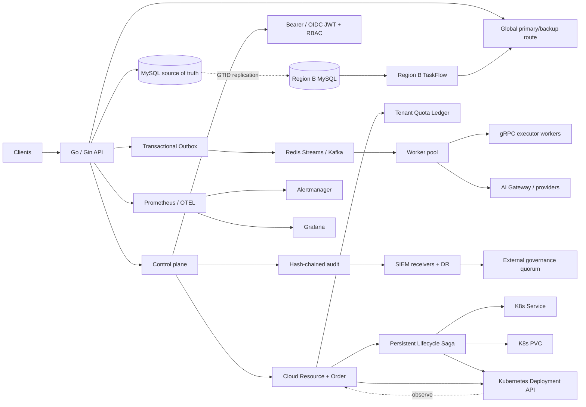

# TaskFlow Go

TaskFlow is a production-oriented Go task platform that combines reliable asynchronous execution, an AI routing/control plane, operational governance, observability, disaster recovery and release security in one repository.

The project is intentionally evidence-driven: reliability features are backed by executable smoke tests, performance claims are tied to reproducible benchmark artifacts, and HA/DR paths are exercised with real MySQL GTID replication, Redis/Kafka, MinIO/S3-compatible storage and Kubernetes/KEDA scenarios.

## Portfolio summary

| Area | Implemented evidence |
| --- | --- |
| Reliable task execution | Transactional Outbox, Redis Streams/Kafka, idempotent SQL claim, retry/reconcile, DLQ and archive lifecycle |
| Cloud resource control | Durable Resource + Order model, quota admission, real Kubernetes Service/PVC/Deployment lifecycle Saga, resize rollback, fail-forward delete, multi-replica workflow fencing; real Kind E2E validates 2-Pod contention and full provision/resize/delete convergence |
| AI application infrastructure | Provider routing, fallback, usage/cost metrics, budget/quota, SLO classes, distributed concurrency, adaptive shedding, fair scheduling |
| GPUFlow scheduling | GPU/CPU/memory placement, accelerator classes, atomic gang scheduling, tenant GPU quotas, weighted FairQueue/aging, checkpoint-safe preemption + requeue, KubeRay RayJob boundary |
| Control plane & governance | OIDC/JWT + RBAC, tamper-evident audit, SIEM delivery/DR, approval quorum, signed governance receipts and anti-rollback key rotation |
| Platform/SRE | Kubernetes/KEDA autoscaling, drain fencing, SLO burn-rate alerts, Alertmanager, Grafana, production runbooks |
| Database/DR | MySQL GTID replica, snapshot bootstrap, writer startup failover, verified backup + binary-log position PITR, multi-region promotion drill |
| Supply-chain security | non-root image, OCI provenance labels, SPDX SBOM, Trivy fixed-CRITICAL gate, digest pinning, GitHub OIDC keyless signing workflow |

Measured single-host release benchmark evidence records a median **5,781.98 RPS**, **26.816 ms P95** and **36.290 ms P99** with zero HTTP errors in the captured five-run set. The multi-region failover drill recorded **RPO lost tasks = 0** and **RTO = 51 seconds** for the tested local topology. These are development/release-evidence measurements, not production SLA claims.

### Start here

- [Architecture and failure semantics](docs/ARCHITECTURE.md)
- [Cloud resource control plane](docs/CLOUD_CONTROL.md)
- [Durable multi-resource lifecycle Saga](docs/CLOUD_SAGA.md)
- [Real Kind lifecycle Saga evidence](docs/CLOUD_SAGA_KIND_E2E_EVIDENCE.md)
- [GPUFlow AI workload scheduler](docs/GPUFLOW.md)
- [GPUFlow validation / resume evidence](docs/GPUFLOW_RESUME_EVIDENCE.md)
- [完整项目链路学习手册（中文，含真实代码）](docs/FULL_PROJECT_GUIDE_ZH.md)
- [Portfolio / resume-ready project summary](docs/PORTFOLIO.md)
- [Interview walkthrough and trade-off guide](docs/INTERVIEW_GUIDE.md)
- [中文简历项目描述](docs/PORTFOLIO_ZH.md)
- [中文面试讲解手册](docs/INTERVIEW_GUIDE_ZH.md)
- [Go 后端 STAR/八股证据对照（2027 秋招）](docs/RESUME_STAR_GO_BACKEND_INTERVIEW_20261009.md)
- [真实云资源订单操作：taskflowctl Go CLI](docs/CLOUD_ORDER_OPERATOR_WORKFLOW.md)
- [Performance release evidence](docs/PERFORMANCE_RELEASE_2026-09-07.md)
- [Control-plane SLO runbook](docs/runbooks/CONTROL_PLANE_SLO.md)
- [Multi-region failover runbook](docs/runbooks/MULTI_REGION_FAILOVER.md)

## Architecture at a glance



MySQL remains the source of truth. Task creation and the corresponding outbox event are committed in one database transaction, eliminating the database-write/message-publish dual-write gap. At-least-once delivery is made safe by conditional SQL state transitions and enqueue-generation fencing. Execution, AI-provider access, governance delivery and regional failover are deliberately separated so each failure domain can be fenced and recovered independently.

The opt-in cloud-resource layer applies the same recovery-first design to a concrete platform scenario. `cloud_resources` stores desired/actual state, bundle snapshots and monotonically increasing generations, while `cloud_orders` records user-visible mutations. `cloud_tenant_quotas` performs transactional CPU/memory/replica admission with row-level locking. `cloud_workflows` + `cloud_workflow_steps` persist a lifecycle Saga across Kubernetes Service, PVC and Deployment: provision failures compensate in reverse order, resize failures restore the previous bundle, and delete uses fail-forward retries until external resources are confirmed absent before releasing quota. See [`docs/CLOUD_CONTROL.md`](docs/CLOUD_CONTROL.md) and [`docs/CLOUD_SAGA.md`](docs/CLOUD_SAGA.md).

## Run locally

### Cloud platform consumer workflow

The `taskflowctl` CLI is a separate Go **customer/operations client** of the
existing OIDC-protected API, not another mock backend. It retrieves tenant
quotas, lists resources and order history, and submits/waits for durable
Provision/Resize/Delete Sagas using caller-stable idempotency keys:

```bash
make taskflowctl-build
export TASKFLOW_ENDPOINT=https://taskflow.internal.example.com
# Obtain an OIDC access token through your identity provider out of band.
export TASKFLOW_ACCESS_TOKEN="$(your-trusted-oidc-login-command)"
./bin/taskflowctl quota team-a
./bin/taskflowctl provision team-a preview-app \
  examples/cloud-resource-order/bundle.json -key=approved-order-001
./bin/taskflowctl workflow <WORKFLOW_ID>
./bin/taskflowctl wait <WORKFLOW_ID> -wait-timeout=10m
```

Production endpoints must use HTTPS, all state changes require explicit
business idempotency keys, and HTTP 202 means **accepted**, not completed.
The locally isolated Keycloak + real HTTP + MySQL regression is:

```bash
sh scripts/taskflowctl-keycloak-smoke.sh
```

This regression needs the separate development Keycloak/TaskFlow staging
containers. See [operator workflow](docs/CLOUD_ORDER_OPERATOR_WORKFLOW.md)
for quota, authorization, retry and provider safety boundaries.

### Backend services

```bash
go mod tidy
docker compose up --build
```

Docker Compose uses the gRPC execution backend by default. To run everything in one process while debugging:

```bash
EXECUTION_BACKEND=local go run ./cmd/server
```

The executor service listens on `:9091` inside Compose/Kubernetes and is not exposed publicly in production manifests.

Run the reusable cross-service smoke test after starting Compose:

```bash
make grpc-smoke
make outbox-smoke
make cloud-control-quota-smoke
make cloud-control-saga-smoke
make cloud-control-kind-e2e
make cloud-control-kind-chaos
make cloud-control-scale-benchmark
```

`cloud-control-kind-e2e` is the heavier local-cluster evidence target: it boots Kind Kubernetes v1.35, two TaskFlow API replicas and real MySQL/Redis, validates cross-Pod Saga lease contention, drives a real Service/PVC/Deployment through provision/resize/delete, and finally enables both background Saga controllers to prove automatic provision/delete convergence without manual reconcile calls.

`cloud-control-kind-chaos` extends that evidence with two controlled real-cluster faults: it kills the workflow-owner Pod after a Kubernetes Service side effect but before the step is committed, then proves lease-expiry takeover preserves the same Service UID; it also injects a post-success provider error and proves the failed step itself is compensated. The fault wrapper is explicitly opt-in and disabled in normal deployments.

`cloud-control-scale-benchmark` measures the same control plane under high order-admission concurrency, one-hot-tenant versus 32-tenant quota contention, and 1/2/4 Saga controller replicas. The frozen 2026-09-22 single-host Kind run shows a real hot-quota-row contention effect and deliberately sub-linear controller scaling; see [`docs/CLOUD_SAGA_SCALE_BENCHMARK_20260922.md`](docs/CLOUD_SAGA_SCALE_BENCHMARK_20260922.md).

The follow-up A/B run compares `locked` versus `atomic_versioned` quota admission and `legacy / baseline / optimized` Saga DB paths. On the hot-tenant c128 point, atomic admission improved throughput `109.66 -> 115.35 orders/s` and P95 `1382 -> 1266ms`; batch claim improved one-controller workflow throughput `4.62 -> 5.18 wf/s`. An 8-worker optimized controller reached `5.38 wf/s` on one replica but created a polling storm (`56 -> 201` compute attempts/workflow as controller replicas grew 1 -> 4), so it is intentionally not the default. See [`docs/CLOUD_SAGA_AB_OPTIMIZATION_20260922.md`](docs/CLOUD_SAGA_AB_OPTIMIZATION_20260922.md).

The 2026-09-23 structural follow-up adds true quota sub-ledgers and durable observation scheduling. Bucketed quota persists a resource-owned bucket so release/compensation returns to the same ledger; real MySQL concurrency tests exposed and then eliminated a first-design `1213` deadlock by using one locked bucket per transaction under `READ COMMITTED`. In the same-run hot c128 benchmark, bucketed accounting cut row-lock waits `1132 -> 653` while end-to-end throughput moved only `111.23 -> 115.31 orders/s`, showing the bottleneck shifted beyond the quota row. A persisted exponential `next_reconcile_at` gate reduced four-controller optimized polling from `206.36 -> 12.48` Compute attempts/workflow with a 40 ms base, while throughput changed `5.403 -> 5.164 wf/s`. See [`docs/CLOUD_SAGA_STRUCTURAL_OPTIMIZATION_20260923.md`](docs/CLOUD_SAGA_STRUCTURAL_OPTIMIZATION_20260923.md).

CI checks module tidiness, formatting, `go vet`, race-enabled unit tests, both binaries, the Docker image, a real MySQL + Redis + gRPC integration stack, and a Redis-outage Transactional Outbox recovery scenario.

Measured load-testing and pprof results are documented in [`docs/PERFORMANCE_REPORT.md`](docs/PERFORMANCE_REPORT.md). The separate [`PERFORMANCE_REPORT.md`](PERFORMANCE_REPORT.md) records the end-to-end Outbox batching/drain experiment.

## Performance

The create-task hot path was optimized from pprof evidence rather than by removing reliability features. The final implementation keeps the MySQL transaction + Transactional Outbox semantics, but uses prepared raw `database/sql` for the two hot INSERTs, batches Outbox claim/publish/settle operations, and can disable synchronous per-request access logging while retaining metrics and tracing.

In the controlled 2026-09-04 local Docker before/after verification (fresh
stack, 100 keep-alive clients, 15 seconds), throughput increased from
**4,280.05 to 5,643.98 RPS (+31.9%)**, P95 latency fell from **38.90 ms to
27.88 ms (-28.3%)**, and P99 fell from **57.52 ms to 38.25 ms (-33.5%)**, with
zero HTTP errors in both runs.

Phase 11 added a fixed-hardware five-run stability baseline for the current
optimized image. On the same 16-logical-CPU i9-9900K host, with 100 concurrent
keep-alive clients for 15 seconds per fresh-stack run, the median was
**5,698.62 RPS**, **27.694 ms P95**, and **38.070 ms P99**. Throughput CV was
**1.06%**, P95 CV **1.19%**, and all **428,418** measured requests returned
HTTP 201 with zero transport errors. See
[`docs/PERFORMANCE_STABILITY_2026-09-06.md`](docs/PERFORMANCE_STABILITY_2026-09-06.md)
and the raw/generated evidence under `perf/phase11-fixed-hardware-20260906/`.

The final post-Phase-21 release capture repeated the same five-run method after
the archive lifecycle/replication and real MinIO/S3 work. Its median was
**5,781.98 RPS**, **26.816 ms P95**, and **36.290 ms P99**, with all **427,554**
requests returning HTTP 201 and zero transport errors. The release set had
higher host load and correspondingly higher variance, so it is evidence of
**no regression**, not a claim that Phase 20-21 improved the create path. See
[`docs/PERFORMANCE_RELEASE_2026-09-07.md`](docs/PERFORMANCE_RELEASE_2026-09-07.md)
and `perf/post-phase21-fixed-hardware-20260907/`.

These are single-host development benchmark numbers, not a production SLA.

Run it with:

```bash
make perf
```

See `docs/PERFORMANCE_REPORT.md` for the pprof evidence, rejected experiment and full before/after table.

For a stability-oriented benchmark, build once and run the same fresh-stack case
multiple times:

```bash
RUNS=5 make perf-multi
```

`perf-multi` keeps each run's raw `load.json` and profiles, records host/Docker
metadata plus the exact benchmark image ID in `environment.txt`, and produces
`summary.json` plus `summary.md` with median, sample variance, standard deviation
and coefficient of variation for throughput and latency metrics. The default
output directory is a timestamped `/tmp/taskflow-perf-multi-*` directory.

Create a task:

```bash
curl -X POST http://localhost:8080/api/v1/tasks \
  -H 'Content-Type: application/json' \
  -d '{"name":"demo","type":"compute","payload":"hello"}'
```

Query a task:

```bash
curl http://localhost:8080/api/v1/tasks/1
```

Readiness:

```bash
curl http://localhost:8080/health/ready
```

Metrics:

```bash
curl http://localhost:8080/metrics
```

Prometheus UI is exposed at `http://localhost:9090` when using Docker Compose.

Retry demo (fails once, then succeeds after the reconciler re-enqueues it):

```bash
curl -X POST http://localhost:8080/api/v1/tasks \
  -H 'Content-Type: application/json' \
  -d '{"name":"retry-demo","type":"fail_once","payload":"demo"}'
```

Permanent failure demo:

```bash
curl -X POST http://localhost:8080/api/v1/tasks \
  -H 'Content-Type: application/json' \
  -d '{"name":"failed-demo","type":"always_fail","payload":"demo"}'
```

## Optional AI task plugin

Phase 2 adds a provider adapter layer on top of the existing `ai_generate`
plugin. The primary provider is configured with `AI_PROVIDER`, `AI_ENDPOINT`,
and `AI_BEARER_TOKEN`. An optional retry fallback provider can be configured
with `AI_FALLBACK_PROVIDER`, `AI_FALLBACK_ENDPOINT`, and
`AI_FALLBACK_BEARER_TOKEN`.

Fallback is attempted only for retryable provider failures such as HTTP
408/429/5xx or transport failures. Permanent configuration/request errors are
returned directly.

Gateways may return optional usage metadata while keeping the existing
`{"result":"..."}` response backward-compatible:

```json
{
  "result": "generated text",
  "provider": "provider-name",
  "model": "model-name",
  "usage": {
    "input_tokens": 12,
    "output_tokens": 34,
    "total_tokens": 46,
    "cost_usd": 0.0012
  }
}
```

When present, usage is exported through Prometheus provider-call, latency,
token, cost, and fallback metrics. W3C trace context is also propagated from
the worker OpenTelemetry span into the provider HTTP request.

TaskFlow keeps AI execution outside the scheduling core. `type=ai_generate` is
routed by the executor worker to an optional HTTP AI Gateway; all other task
types continue through the normal demo/business executor path.

Configure the executor worker with:

```bash
AI_PROVIDER=primary
AI_ENDPOINT=http://your-ai-gateway/generate
AI_BEARER_TOKEN=optional-secret
AI_FALLBACK_PROVIDER=fallback
AI_FALLBACK_ENDPOINT=http://your-backup-gateway/generate
AI_FALLBACK_BEARER_TOKEN=optional-backup-secret
AI_TIMEOUT_MS=30000
EXECUTOR_METRICS_ADDR=:9093
```

The executor metrics endpoint exports `taskflow_ai_provider_calls_total`,
`taskflow_ai_provider_duration_seconds`, `taskflow_ai_tokens_total`,
`taskflow_ai_cost_usd_total`, and `taskflow_ai_fallback_total`. The Compose
stack exposes it on `127.0.0.1:19093/metrics` and Prometheus scrapes
`executor-worker:9093` directly.

The gateway contract is provider-neutral. TaskFlow sends:

```json
{
  "task_id": 123,
  "name": "summarize",
  "prompt": "Summarize this document",
  "retry_count": 0
}
```

and expects:

```json
{"result":"...generated output..."}
```

HTTP `408`, `429`, `5xx` and transport failures are retryable. Other `4xx`
responses and malformed successful responses are terminal. If `AI_ENDPOINT` is
unset, `ai_generate` fails permanently instead of silently falling back to a
non-AI executor. In gRPC mode, AI tasks receive a task-specific RPC deadline
longer than the ordinary executor deadline so the configured AI timeout is not
silently truncated by the default 5-second gRPC limit.

### Phase 3: OpenAI-compatible smart routing

Phase 3 adds an `openai` provider kind that speaks the common
`/v1/chat/completions` request/response shape while preserving the Phase 2
provider-neutral gateway adapter. Each provider can declare a model,
capabilities, and input/output price hints:

```bash
AI_PROVIDER=openai-primary
AI_PROVIDER_KIND=openai
AI_ENDPOINT=https://provider.example.com
AI_MODEL=model-a
AI_CAPABILITIES=text,reasoning
AI_INPUT_COST_PER_1M=1.0
AI_OUTPUT_COST_PER_1M=4.0

AI_FALLBACK_PROVIDER=openai-cheap
AI_FALLBACK_KIND=openai
AI_FALLBACK_ENDPOINT=https://backup.example.com
AI_FALLBACK_MODEL=model-b
AI_FALLBACK_CAPABILITIES=text
AI_FALLBACK_INPUT_COST_PER_1M=0.2
AI_FALLBACK_OUTPUT_COST_PER_1M=1.0

AI_ROUTING_STRATEGY=balanced
AI_PROVIDER_CIRCUIT_FAILURES=3
AI_PROVIDER_CIRCUIT_OPEN_MS=10000
AI_DEFAULT_OUTPUT_TOKENS=256
```

Routing strategies are `balanced`, `cost`, `latency`, and `reliability`.
Candidates are first filtered by an optional model, capability and cost budget,
then ranked using configured price hints plus runtime EWMA latency and retryable
failure rate. Each provider has its own circuit breaker so repeatedly unhealthy
providers are skipped until the breaker can probe again.

Plain payload strings remain backward-compatible. Advanced routing is opt-in by
using a JSON envelope inside the task payload:

```json
{
  "prompt": "Explain why this deployment failed",
  "model": "model-a",
  "capability": "reasoning",
  "max_cost_usd": 0.02,
  "routing_strategy": "reliability"
}
```

The executor additionally exports `taskflow_ai_route_selections_total` and
`taskflow_ai_provider_circuit_skips_total` so routing decisions and provider
health governance can be inspected in Prometheus.

### Phase 4: durable routing governance, audit and replay

Phase 4 moves routing governance out of executor process memory. The API keeps
a versioned routing policy in MySQL and every task execution carries the latest
policy snapshot over gRPC. Executor replicas remain stateless and do not need
database access. API replicas poll the shared policy row, so a policy update is
observed across replicas without restarting the executor fleet.

Read or hot-update the durable policy:

```bash
curl http://localhost:8080/api/v1/ai/routing-policy

curl -X PUT http://localhost:8080/api/v1/ai/routing-policy \
  -H 'Content-Type: application/json' \
  -d '{"strategy":"cost","default_output_tokens":256}'
```

Each settled AI attempt stores one `ai_route_audits` row in the same MySQL
transaction as the task state transition. The audit contains the policy
version, candidate snapshot, scores, EWMA latency/failure inputs, provider
attempt chain, selected provider/model, token usage and cost. This preserves
failed and retried attempts instead of only the final route.

```bash
curl http://localhost:8080/api/v1/tasks/123/ai-route-audits
```

An audit can be replayed against its captured candidate snapshot without
calling a model again. Supplying a different strategy is useful for answering
counterfactual questions such as "what would latency routing have selected?":

```bash
curl -X POST \
  http://localhost:8080/api/v1/tasks/123/ai-route-audits/7/replay \
  -H 'Content-Type: application/json' \
  -d '{"strategy":"latency"}'
```

The response reports the original provider, replay provider and whether the
selection would remain the same. `scripts/ai-phase4-smoke.sh` verifies policy
hot-update, route audit persistence, counterfactual replay and policy recovery
after recreating the API container.

### Phase 5: durable budget, quota and admission control

Phase 5 adds MySQL-backed AI budget accounts for both `global` and `tenant`
scopes. Budget checks happen in the taskflow worker before the gRPC executor is
called, so multiple API/worker replicas share one transactional source of truth
instead of maintaining per-process counters.

```bash
# Global budget. The key is normalized to "global".
curl -X PUT http://localhost:8080/api/v1/ai/budgets/global/global \
  -H 'Content-Type: application/json' \
  -d '{"limit_usd":100,"limit_tokens":1000000}'

# Per-tenant budget.
curl -X PUT http://localhost:8080/api/v1/ai/budgets/tenant/acme \
  -H 'Content-Type: application/json' \
  -d '{"limit_usd":5,"limit_tokens":500000}'

curl http://localhost:8080/api/v1/ai/budgets
curl http://localhost:8080/api/v1/ai/budgets/tenant/acme
```

`0` means unlimited for that dimension; if both limits are zero, the account is
disabled and does not add reservation/settlement work to AI tasks. Advanced AI
payloads can opt into tenant accounting with `tenant_id`:

```json
{
  "prompt": "summarize the incident",
  "tenant_id": "acme",
  "max_cost_usd": 0.02,
  "routing_strategy": "reliability"
}
```

Before model execution, the worker atomically reserves both the applicable
global and tenant budgets. The USD reservation uses task `max_cost_usd` when
present, otherwise `AI_BUDGET_DEFAULT_RESERVE_USD`; token reservation uses an
input estimate plus the current durable routing policy's default output-token
allowance. If either account is over quota, the task fails permanently before
any provider call.

On successful execution, task success, route audit and actual USD/token budget
settlement commit in one MySQL transaction. Failed or retried executions release
the reservation in the same task-state transition transaction. Metrics include
`taskflow_ai_budget_admissions_total`, `taskflow_ai_budget_settled_usd_total`,
`taskflow_ai_budget_settled_tokens_total` and `taskflow_ai_budget_overrun_total`.
`scripts/ai-phase5-smoke.sh` verifies global+tenant settlement, USD and token
denials before provider execution, and reservation release after a permanent
provider failure.

### Phase 6: SLO classes, per-model concurrency and backpressure

Phase 6 adds non-preemptive priority scheduling inside each executor worker.
Every provider/model has its own concurrency gate. Requests already executing
are never interrupted, but queued requests are admitted in SLO priority order:

```text
realtime > standard > batch
```

An advanced AI payload can select its SLO class:

```json
{
  "prompt": "generate an incident summary",
  "slo_class": "realtime"
}
```

Defaults are configurable independently for queueing and total execution time:

```bash
AI_MAX_CONCURRENCY=4
AI_FALLBACK_MAX_CONCURRENCY=4

AI_SLO_REALTIME_QUEUE_MS=50
AI_SLO_REALTIME_TIMEOUT_MS=3000
AI_SLO_STANDARD_QUEUE_MS=1000
AI_SLO_STANDARD_TIMEOUT_MS=15000
AI_SLO_BATCH_QUEUE_MS=5000
AI_SLO_BATCH_TIMEOUT_MS=30000
```

When a provider/model is saturated, a request waits only for its SLO queue
budget. If the queue budget expires, the router can try the next eligible
provider. If every candidate is saturated, realtime fails fast while standard
and batch return retryable backpressure. Total SLO deadline exhaustion is
tracked separately from queue saturation and is not counted as a provider
health failure, so it cannot incorrectly open the provider circuit breaker.

The local concurrency limit remains **per executor-worker process/Pod**. Phase 7
adds an optional Redis-backed distributed coordinator for deployments that also
need a hard cluster-global provider/model quota.

Prometheus exposes `taskflow_ai_model_concurrency_active`,
`taskflow_ai_model_concurrency_queued`, `taskflow_ai_model_queue_wait_seconds`,
`taskflow_ai_backpressure_total` and `taskflow_ai_slo_requests_total`.
`scripts/ai-phase6-smoke.sh` verifies real container-level saturation, fallback
to an available provider and a distinct realtime SLO deadline failure.

### Phase 7: distributed concurrency and adaptive load shedding

Set `AI_GLOBAL_MAX_CONCURRENCY` (and optionally
`AI_FALLBACK_GLOBAL_MAX_CONCURRENCY`) to a positive value to enable a second,
Redis-backed admission gate after the local in-process gate:

```text
request
  -> local provider/model gate
  -> Redis provider/model lease
  -> provider call
```

`0` disables the distributed gate, preserving the Phase 6 behavior and avoiding
an executor Redis dependency when a global limit is not required. Redis leases
are stored in a sorted set keyed by provider/model. Each member carries an
expiry timestamp, is renewed while the provider call is alive, and is removed
on normal completion. If an executor is killed, the next admission removes the
expired member before checking the global limit, so crashed workers cannot leak
capacity indefinitely.

```bash
AI_GLOBAL_MAX_CONCURRENCY=5
AI_FALLBACK_GLOBAL_MAX_CONCURRENCY=3
AI_DISTRIBUTED_LEASE_MS=30000
AI_CONCURRENCY_REDIS_PREFIX=taskflow:ai:concurrency
```

The global limit composes with the local one. For example, three executor Pods
can each keep `AI_MAX_CONCURRENCY=4` for local isolation while a shared
`AI_GLOBAL_MAX_CONCURRENCY=5` prevents the cluster from sending more than five
concurrent requests to that provider/model.

Adaptive load shedding is enabled by default. The executor derives a pressure
state from local model-queue depth plus observed provider latency and retryable
failure rate:

```text
normal -> degraded -> overloaded
```

Realtime work is preserved. Under degraded pressure, batch requests receive a
shorter queue budget. Under overloaded pressure, batch work is shed with a
retryable error before provider execution, while standard work receives a short
queue budget so routing can reach an alternate provider sooner.

```bash
AI_ADAPTIVE_LOAD_SHEDDING=true
AI_PRESSURE_DEGRADED_QUEUE=4
AI_PRESSURE_OVERLOADED_QUEUE=16
AI_PRESSURE_DEGRADED_FAILURE_RATE=0.2
AI_PRESSURE_OVERLOADED_FAILURE_RATE=0.5
AI_PRESSURE_DEGRADED_LATENCY_MS=2000
AI_PRESSURE_OVERLOADED_LATENCY_MS=5000
```

Phase 7 adds `taskflow_ai_global_concurrency_active`,
`taskflow_ai_global_concurrency_limit`, `taskflow_ai_global_concurrency_total`,
`taskflow_ai_load_shedding_total`, `taskflow_ai_system_pressure_state`, and
`taskflow_ai_executor_queue_depth`. `scripts/ai-phase7-smoke.sh` runs two real
executor containers against one Redis instance, verifies cross-worker global
backpressure/fallback, SIGKILL lease recovery, and overloaded batch shedding.

### Phase 8: hedged requests and tail-latency control

Phase 8 optionally hedges only `realtime` AI work while the executor pressure
state is `normal`. The router starts the best-ranked provider immediately and
launches the second eligible provider only if the first request is still
running after `AI_HEDGE_DELAY_MS`. The first successful result wins and the
other request is canceled through `context.Context`.

Hedging is disabled by default so upgrades do not silently increase model
traffic or spend:

```bash
AI_HEDGE_ENABLED=false
AI_HEDGE_DELAY_MS=100
AI_HEDGE_CANCEL_WAIT_MS=100
AI_HEDGE_MAX_EXTRA_COST_USD=0.01
```

The hedge is skipped when there are fewer than two eligible providers, the
request is not realtime, the executor is degraded/overloaded, the task sets
`disable_hedge=true`, or the secondary candidate violates the extra-cost guard.
When a task also supplies `max_cost_usd`, both candidate estimates must be known
and their combined estimated cost must fit inside that task budget before a
hedge can launch.

```json
{
  "prompt": "summarize the incident",
  "slo_class": "realtime",
  "disable_hedge": false
}
```

Route audits record `hedge_triggered`, `hedge_delay_ms`, `hedge_winner`, and
`hedge_extra_cost_usd`. If a losing hedge actually returns usage before
cancellation wins the race, its known tokens/cost are included in the audit's
total usage so Phase 5 settlement does not under-account duplicated work. A
canceled loser is recorded as `hedge_canceled` and is not treated as a provider
health failure.

Prometheus exposes `taskflow_ai_hedge_requests_total`,
`taskflow_ai_hedge_delay_seconds`, and `taskflow_ai_hedge_extra_cost_usd_total`.
`scripts/ai-phase8-smoke.sh` uses a slow primary plus a fast secondary and
verifies both the hedged winner and the task-level opt-out path. In the local
container smoke, the hedged route audit completed in about 102 ms versus about
1052 ms for the same slow primary with hedging disabled.

### Phase 9: tenant-aware fair scheduling and starvation protection

Phase 9 extends the Phase 6 provider/model concurrency gate with tenant-aware
admission. It is disabled by default so an upgrade preserves the original
strict SLO/FIFO behavior:

```bash
AI_TENANT_FAIR_SCHEDULING=false
AI_TENANT_MAX_CONSECUTIVE=2
AI_TENANT_STARVATION_MS=5000
```

When enabled, each AI request's existing `tenant_id` participates in local
provider/model scheduling. Requests without a tenant are grouped into an
internal default tenant. Tenant identifiers are deliberately not exposed as
Prometheus labels to avoid unbounded metric cardinality.

Normal scheduling still starts from SLO priority:

```text
realtime > standard > batch
```

Within the same effective priority, once one tenant has received
`AI_TENANT_MAX_CONSECUTIVE` consecutive admissions and another tenant is
waiting, the other tenant is rotated in. Starvation protection uses aging: for
every `AI_TENANT_STARVATION_MS` spent waiting, a request improves its effective
priority by one level. A long-waiting batch request therefore eventually
reaches realtime effective priority instead of being starved forever by a
continuous realtime stream. Running provider calls remain non-preemptive.

Route audits record `tenant_fair_scheduling`, `tenant_max_consecutive`, and
`tenant_starvation_ms`. Prometheus exposes
`taskflow_ai_tenant_fair_scheduling_total{action="tenant_rotated"}` and
`{action="starvation_promoted"}`. `scripts/ai-phase9-smoke.sh` validates both
behaviors against a real one-slot slow provider: tenant B is admitted before
two older tenant-A waiters after tenant A reaches its consecutive limit, and an
aged batch request completes before a newly queued realtime request. The smoke
also verifies that `taskflow_ai_model_concurrency_queued` becomes non-zero while
a request is actually blocked inside the concurrency gate; tenant IDs are not
added to that metric's labels.

### Phase 10: distributed tenant concurrency quotas

Phase 9 protects fairness inside one executor process. Phase 10 adds an
optional Redis-backed tenant quota so the same tenant cannot consume all
provider/model capacity by spreading requests across multiple executor Pods.
It is disabled by default, preserving Phase 1.5-9 behavior:

```bash
AI_DISTRIBUTED_TENANT_QUOTA=false
AI_TENANT_GLOBAL_MAX_CONCURRENCY=0
AI_TENANT_CONCURRENCY_OVERRIDES=""
```

When enabled, `AI_TENANT_GLOBAL_MAX_CONCURRENCY` is the default concurrent
lease limit for each tenant on each provider/model. Optional static quota
profiles can assign larger or smaller shares without changing request payloads:

```bash
AI_DISTRIBUTED_TENANT_QUOTA=true
AI_TENANT_GLOBAL_MAX_CONCURRENCY=1
AI_TENANT_CONCURRENCY_OVERRIDES="gold=4,silver=2"
```

An override replaces the default limit for that tenant. Requests with an empty
`tenant_id` use the same internal default-tenant identity as Phase 9. Admission
order is deliberately:

```text
local SLO/fair gate
  -> distributed tenant quota
  -> Phase 7 global provider/model concurrency
  -> provider call
```

This prevents a tenant that is already over quota from occupying a scarce
global provider/model lease while it waits. Tenant quotas are scoped by
tenant + provider + model, so saturation by tenant A does not block tenant B.
The existing Phase 9 SLO priority, tenant rotation, and starvation aging remain
unchanged before the distributed admission stage.

Redis lease keys contain a deterministic hash of the normalized tenant ID, not
the tenant ID itself. Prometheus exposes
`taskflow_ai_tenant_distributed_concurrency_total{provider,model,slo_class,outcome}`
without a tenant label, avoiding high-cardinality tenant metrics. Route audits
record `tenant_distributed_quota` and the effective
`tenant_concurrency_limit` used for the request.

`scripts/ai-phase10-smoke.sh` starts two executor workers sharing Redis and a
slow provider. It verifies that a tenant holding its quota on worker A is
throttled on worker B, a different tenant remains admissible, the distributed
quota metric reports `tenant_backpressure`, tenant IDs are absent from metric
labels, and the live Redis tenant lease key does not expose the plaintext
tenant ID.

### Phase 11: runtime-governed tenant quota profiles

Phase 11 removes the executor-restart requirement for tenant quota profile
changes. The Phase 10 environment variables remain the safe static fallback,
but operators can now persist a versioned runtime policy in MySQL:

```http
PUT /api/v1/ai/tenant-quota-policy
Content-Type: application/json

{
  "enabled": true,
  "default_limit": 1,
  "overrides": "gold=4,silver=2"
}
```

`GET /api/v1/ai/tenant-quota-policy` returns the persisted policy. Runtime
writes use strict validation and canonicalize overrides, so malformed entries
are rejected rather than silently ignored. `DELETE
/api/v1/ai/tenant-quota-policy` clears runtime governance and immediately
returns execution to the Phase 10 static environment configuration.

The policy row has an explicit `tenant_quota_managed` flag for upgrade safety.
Rows created before Phase 11 therefore do not accidentally override existing
Phase 10 environment settings after migration. Each update increments the same
durable routing-policy version used by Phase 4. Queue workers snapshot the
current policy at execution time, propagate the tenant quota fields over gRPC,
and the executor applies the runtime profile when `tenant_quota_managed=true`.
No executor restart is needed.

Route audits record `tenant_quota_source` as `runtime` or `static`, together
with the effective limit and policy version. Runtime governance does not add a
tenant ID to Prometheus labels, and Phase 10's hashed Redis tenant keys remain
unchanged.

`scripts/ai-phase11-smoke.sh` starts the executor with static tenant quotas
disabled, enables a runtime quota through the HTTP governance API, recreates
only the API/queue process to prove MySQL persistence, and verifies the same
executor container enforces the new limit. It then clears runtime governance
without restarting the executor and verifies execution falls back to the
disabled static configuration.

### Phase 12: queue-aware autoscaling guardrails

Phase 12 hardens the existing Redis Stream backlog signal before it is used by
KEDA. A queue metric that was collected successfully several seconds ago is not
equivalent to a queue metric that is still known to be current, so TaskFlow now
publishes two explicit health signals alongside `taskflow_queue_backlog`:

```text
taskflow_queue_stats_fresh
taskflow_queue_stats_last_success_timestamp_seconds
```

`taskflow_queue_stats_fresh` is `1` only after a successful collection and is
set to `0` immediately when Redis queue statistics cannot be read. Collection
failure deliberately does **not** zero the last good backlog value; doing that
would turn an observability failure into a false "queue empty" signal and could
cause an unsafe scale-down. The last-success timestamp is also preserved until
the next successful sample so Prometheus can reject metrics that are old even
if a scrape target itself disappears.

The collection interval is configurable with:

```bash
QUEUE_STATS_INTERVAL_MS=5000
```

`deploy/k8s/keda-scaledobject.example.yaml` now uses a guarded Prometheus query
that returns backlog only when freshness is `1` and the last successful sample
is less than 30 seconds old. `ignoreNullValues=false` converts a rejected/empty
query into a scaler error instead of a zero metric. After three consecutive
scaler failures KEDA falls back to four TaskFlow replicas. Scale-down also has a
300-second stabilization window, while scale-up can double capacity or add up
to four Pods per 15-second period.

The TaskFlow Pod template now carries Prometheus scrape annotations for its
`/metrics` endpoint. `scripts/phase12-autoscaling-smoke.sh` accelerates queue
sampling for the test, pauses Redis without destroying Stream/group state,
verifies freshness changes from `1` to `0` while the last-good timestamp is
preserved and the error counter advances, unpauses Redis, and verifies the
same TaskFlow process recovers freshness without a restart. A static KEDA
guardrail checker is also part of the gate and CI.

The fixed-hardware five-run benchmark that had remained in the planned list was
already captured earlier on 2026-09-06. Its artifacts are retained under the
historical path `perf/phase11-fixed-hardware-20260906/`; that directory name
predates the Phase 11 runtime-governance numbering correction and does not mean
the benchmark is part of Phase 11.

### Phase 13: graceful autoscaling scale-down and drain fencing

Phase 13 makes Kubernetes scale-down safe for both queue consumers and gRPC
executors. TaskFlow now separates the queue-intake context from the execution
context. On SIGTERM it immediately enters draining state, fails readiness,
sets `taskflow_process_draining=1`, and cancels only queue intake. Tasks that
were already claimed keep their execution context and heartbeat lease alive so
they can settle normally. `taskflow_worker_inflight` exposes the number of
claimed tasks still executing.

The drain is bounded by `DRAIN_TIMEOUT_MS` (default 30000 ms). If all in-flight
work finishes before the deadline, shutdown is graceful. If the deadline is
exceeded, TaskFlow cancels the execution context; the existing worker shutdown
path moves owned work back to `pending` when possible, while the durable lease
and stale-run reconciler remain the final crash-recovery fence. A short
`DRAIN_FENCE_MS` (default 1000 ms) keeps the HTTP process alive after readiness
flips so Kubernetes and Prometheus can observe the drain state before process
shutdown.

The executor worker uses the same bounded drain timeout. SIGTERM first marks
gRPC health `NOT_SERVING`, preventing new RPC admission, then calls
`GracefulStop` so active requests can finish. Only after the configured timeout
does it force-cancel remaining RPCs. Metrics remain available during this
period through `taskflow_executor_inflight`, `taskflow_process_draining`, and
`taskflow_drain_outcomes_total{role,outcome}`.

Kubernetes Pod templates now use a 45-second termination grace period. TaskFlow
readiness checks every two seconds with `failureThreshold: 1`, while executor
readiness/liveness use the native gRPC health probe rather than a TCP socket
check. This means an executor that has begun draining is no longer considered
ready merely because port 9091 is still open.

`scripts/phase13-drain-smoke.sh` verifies both directions with a real slow AI
provider. It SIGTERMs an executor during an active gRPC call and requires that
call to complete before the executor exits. It then SIGTERMs a one-worker
TaskFlow process with one task running and a second task pending: the running
task must complete, the follower must remain pending while intake is fenced,
and the follower must succeed after TaskFlow restarts. The smoke also observes
the readiness and in-flight metrics during the drain rather than relying only
on final task status.

### Phase 14: Kubernetes disruption and rollout availability guardrails

Phase 14 closes the gap between graceful Pod shutdown and cluster-level
availability policy. `deploy/k8s/taskflow-pdb.yaml` and
`deploy/k8s/executor-pdb.yaml` each require at least one replica to remain
available during voluntary disruptions such as node drain. Both workloads keep
an autoscaling floor of two replicas, so one voluntary eviction still leaves a
serving replica while the evicted Pod follows the Phase 13 drain path.

Both Deployments now use an explicit rolling-update policy with
`maxUnavailable: 0` and `maxSurge: 1`. A normal Deployment rollout therefore
creates replacement capacity before intentionally removing an existing ready
Pod. Preferred pod anti-affinity spreads replicas first across distinct hosts
and then across zones when the cluster topology allows it. The rules are soft
rather than hard so a single-node development cluster or a temporarily
capacity-constrained production cluster remains schedulable instead of
deadlocking a rollout.

`scripts/phase14-k8s-check.py` validates the PDB selectors, replica floors,
rollout strategy and host/zone placement rules. It checks both the CPU HPA and
the optional Phase 12 KEDA scaler so either autoscaling mode preserves the
availability assumptions. `scripts/phase14-availability-smoke.sh` also reruns
the Phase 13 termination-budget checker because disruption protection is only
useful if the Pod still has enough time to drain after Kubernetes selects it
for eviction.

### Phase 15: distributed reconciler coordination

Phase 15 removes the queue amplification that would otherwise appear when
multiple TaskFlow replicas run the same periodic reconciler. Every replica still
starts a reconciler loop, but only the holder of a Redis leadership lease may
recover stale `running` rows, scan ready `pending` rows, and enqueue them. The
lease is retained across reconcile periods instead of being released after
every scan, so two slightly staggered replicas cannot serialize duplicate scans
through a short-lived mutex.

Leadership uses `SET NX` with a random owner token and a bounded TTL. The active
leader renews the lease with an owner-checked Lua `PEXPIRE`; losing Redis or the
owner token cancels the lease context, which also cancels the current scan or
enqueue operation. Shutdown releases the lease with an owner-checked Lua
`DEL`, preventing an old process from deleting a lock already acquired by a
new leader. Defaults are `RECONCILE_DISTRIBUTED_COORDINATION=true`,
`RECONCILE_LOCK_KEY=taskflow:reconciler:leader`, and
`RECONCILE_LEASE_MS=15000`.

TaskFlow also cancels the reconciler leadership context as soon as Phase 13
draining begins, before waiting for in-flight task execution. A replacement Pod
can therefore take over reconciliation while the terminating Pod is still
finishing already-claimed work instead of waiting for the full drain deadline.

The existing SQL `Claim` transition remains the final correctness fence. Leader
election reduces redundant Redis work; it does not replace idempotent task
claiming or lease recovery. Prometheus exposes leadership acquisition,
contention/loss, stale-task recovery, and reconciler enqueue counts without
putting replica IDs into metric labels.

`scripts/phase15-reconciler-smoke.sh` starts two real TaskFlow processes against
the same MySQL and Redis. Twenty directly inserted ready tasks must produce
exactly twenty Redis Stream entries, not one copy per replica. The smoke then
SIGTERMs the current leader, requires the surviving replica to acquire the
lease, and verifies a second five-task batch adds exactly five more messages.
`scripts/phase15-coordination-check.py` keeps the Redis owner-token and runtime
wiring invariants in the static gate and CI.

### Phase 16: per-task enqueue visibility and generation fencing

Phase 16 closes the duplicate-delivery gap that remains even with one active
reconciler leader. A ready task now carries an `enqueue_generation`, the latest
generation confirmed broker-visible, and a short enqueue publication lease.
The outbox dispatcher and reconciler must first claim that MySQL lease before
publishing. After a successful broker write they confirm the same generation as
visible. Consecutive reconciler scans therefore skip a still-pending task whose
current generation is already visible, and a delayed `task.created` outbox row
settles without publishing again if the reconciler already made generation 1
visible.

Every Redis Stream and Kafka task message now carries the enqueue generation.
The worker's SQL `Claim` requires both `status=pending` and an exact generation
match. Any transition from `running` back to `pending` increments the generation,
including retry, shutdown requeue, and stale-running recovery. A delayed
generation-1 message therefore cannot claim a generation-2 retry; the matching
generation-2 message is the only one allowed to start that execution attempt.

`ENQUEUE_VISIBILITY_LEASE_MS` defaults to 10000 ms. The lease deliberately
expires if a publisher crashes before broker I/O, allowing the reconciler to
recover the task. If the broker accepted a message and a worker has already
durably moved that same generation out of `pending`, the outbox treats that
state change as proof of broker visibility and converges both the generation
marker and outbox row without publishing again. A later duplicate remains
possible only in the narrower window where the broker accepted the message,
the publisher crashed before MySQL confirmation, and no worker durably claimed
that generation before the enqueue lease expired. Preserving at-least-once
recovery is safer than marking work visible before it actually reaches the
broker; eliminating that last ambiguity would require a transaction spanning
the database and broker or broker-native idempotent publication.

Prometheus exposes `taskflow_enqueue_fencing_total{source,outcome}` and
`taskflow_enqueue_confirmed_total{source}`. `scripts/phase16-enqueue-fencing-smoke.sh`
uses real MySQL and Redis to verify outbox/reconciler cross-path deduplication,
one publish per generation across repeated scans, a legitimate `fail_once`
generation-2 retry, stale-generation execution rejection, and recovery after an
abandoned enqueue lease expires. It also recreates the broker-accepted / worker-
executed / publisher-not-confirmed crash state and requires the outbox to settle
without another Stream append. `scripts/phase16-fencing-check.py` keeps the
schema, queue envelope, claim fence, retry-generation and deployment config
invariants in the static gate.

### Phase 17: Redis Stream acknowledged-history compaction

Phase 17 bounds Redis Stream history without weakening at-least-once delivery.
A periodic Redis-only compactor derives a desired trim boundary from two
independent retention limits: acknowledged history older than
`QUEUE_ACK_RETENTION_MS` and history beyond
`QUEUE_ACK_RETENTION_MAX_ENTRIES`. The more aggressive boundary wins, but it is
never applied directly as a blind `MAXLEN` trim.

The safety check and exact `XTRIM ... MINID` execute in one Redis Lua script.
Inside that atomic operation the compactor inspects every consumer group with
`XINFO GROUPS`. For each group, its `last-delivered-id` protects all undelivered
messages, while the group's lowest `XPENDING` ID protects delivered messages
that are still waiting for ACK. The global safe boundary is the oldest of those
group boundaries. Keeping group discovery, PEL inspection, and trimming in one
Redis operation also closes the check/trim race where a new consumer group
could otherwise be created from historical ID `0` after the safety snapshot.
As a result, a crashed consumer's message payload remains available for
`XAUTOCLAIM`, and an independent second consumer group cannot lose work merely
because the TaskFlow worker group has already ACKed the same Stream entry.

The production defaults are:

- `QUEUE_COMPACTION_ENABLED=true`
- `QUEUE_COMPACTION_INTERVAL_MS=30000`
- `QUEUE_ACK_RETENTION_MS=86400000` (24 hours)
- `QUEUE_ACK_RETENTION_MAX_ENTRIES=100000`

Either retention limit can be set to `0` to disable that individual boundary.
If pending or undelivered work is older than the desired cutoff, safety wins and
the Stream may temporarily exceed the configured count/age target until that
work is ACKed or the protecting consumer group is removed. This is intentional:
the limit applies to trim-eligible acknowledged history, not to live recovery
state.

Prometheus exposes
`taskflow_queue_compaction_runs_total{outcome=trimmed|noop|error}`,
`taskflow_queue_compaction_trimmed_entries_total`, and
`taskflow_queue_compaction_protected_runs_total`.
`scripts/phase17-compaction-smoke.sh` uses real Redis/MySQL to verify count-based
history bounding, preservation and `XAUTOCLAIM` recovery of a pending Phase 16
generation message, protection of a second consumer group's undelivered work,
and independent time-based retention. `scripts/phase17-compaction-check.py`
keeps the atomic Lua `MINID`, multi-group, PEL, configuration, metrics, Compose,
and Kubernetes invariants in the static gate and CI.

### Phase 18: poison-message quarantine and controlled replay

Phase 18 prevents malformed or permanently unprocessable queue deliveries from
hot-looping forever. Redis and Kafka decode failures now return a structured
`PoisonDeliveryError` that preserves the source backend/queue, source delivery
ID, raw envelope, failure class/reason, and any task ID or enqueue generation
that could still be recovered. A syntactically valid envelope that references a
task no longer present in MySQL is also classified as an `orphan` poison
delivery instead of being silently treated as an ordinary duplicate.

The worker first writes poison evidence to the durable MySQL
`queue_dead_letters` table and only ACKs the Redis delivery or commits the Kafka
offset after that write succeeds. The source backend/queue/delivery ID has a
composite unique key, so if broker ACK fails and the same poison delivery is
redelivered, quarantine is idempotent rather than creating duplicate diagnosis
rows. If MySQL quarantine fails, the broker delivery remains unacknowledged and
available for recovery.

Operators can inspect dead letters through:

- `GET /api/v1/queue/dead-letters`
- `GET /api/v1/queue/dead-letters/:id`
- `POST /api/v1/queue/dead-letters/:id/replay`

Replay may reuse salvaged metadata or supply repaired `task_id` and
`enqueue_generation` values. Before publishing, the service requires that
MySQL still contains that task in `pending` state at exactly that generation.
This prevents an operator replay from bypassing the Phase 16 stale-generation
fence. When that generation is not yet marked broker-visible, replay also takes
the same Phase 16 per-task enqueue visibility lease used by the outbox and
reconciler. After broker publish, `enqueued_generation` and the DLQ replay state
are settled together in one MySQL transaction, preventing replay from racing
the reconciler into an avoidable duplicate Stream entry. If MySQL already marks
that generation broker-visible, replay is rejected rather than guessing that
the quarantined copy was the only copy. This keeps DLQ replay subordinate to
the Phase 16 visibility fence instead of using the SQL execution fence as an
excuse to create duplicate broker entries. A short MySQL replay lease
(`QUEUE_DLQ_REPLAY_LEASE_MS`, default 30000) prevents concurrent API calls from
successfully replaying the same dead letter. As with Phase 16 publishing, the
narrow broker-accepted / MySQL-settlement crash window cannot be made atomic
without a broker/DB transaction.

Prometheus exposes
`taskflow_queue_poison_deliveries_total{backend,class,outcome}` and
`taskflow_queue_dead_letter_replays_total{outcome}`. The real Redis/MySQL smoke
test injects a malformed task ID, an orphan task envelope, and a malformed
generation that is repaired through the replay API. It verifies durable raw
payload retention, ACK after quarantine, no duplicate DLQ hot loop, successful
replay of the corrected generation, and rejection of a stale generation.
`scripts/phase18-dlq-check.py` keeps the schema, decode metadata, quarantine
ordering, replay fencing, metrics, Compose/Kubernetes wiring, and API routes in
the static gate and CI.

### Phase 19: dead-letter lifecycle governance

Phase 19 bounds the durable MySQL DLQ without sacrificing active replay safety
or the forensic history introduced in Phase 18. The background lifecycle job
uses separate age windows for successfully replayed evidence and unresolved
quarantined evidence. The count-based capacity target is intentionally more
conservative: it evicts only `replayed` terminal evidence. Fresh unresolved
`quarantined` rows and all `replaying` rows are protected, even when that means
the table temporarily exceeds the configured capacity.

Production defaults are:

- `QUEUE_DLQ_LIFECYCLE_ENABLED=true`
- `QUEUE_DLQ_LIFECYCLE_INTERVAL_MS=60000`
- `QUEUE_DLQ_REPLAYED_RETENTION_MS=604800000` (7 days)
- `QUEUE_DLQ_QUARANTINED_RETENTION_MS=2592000000` (30 days)
- `QUEUE_DLQ_REPLAY_AUDIT_RETENTION_MS=7776000000` (90 days)
- `QUEUE_DLQ_MAX_ENTRIES=100000`

Setting an age retention or the capacity to `0` disables that individual
boundary. Safety takes precedence over the target: unresolved quarantine and
active/recoverable replay state are protected from count-based eviction instead
of being deleted merely to satisfy a row-count limit. Age-based quarantine
retention remains an explicit, separately configurable operator policy.

Lifecycle candidate selection uses `FOR UPDATE SKIP LOCKED`, and destructive
queries re-check replay state and retention predicates at delete time. This
closes the race where a row selected as `quarantined` could otherwise transition
to `replaying` immediately before cleanup deletes it.

Every replay attempt against an existing dead letter now writes an append-only
`queue_dead_letter_replay_audits` snapshot containing the dead-letter ID,
source backend/queue/delivery ID, failure class, requested task/generation,
outcome and failure reason. A successful replay audit is inserted in the same
MySQL transaction that confirms Phase 16 broker visibility and marks the DLQ
replayed. The audit table has an independent longer retention, so operator
history survives deletion of the parent DLQ row.

Additional operator APIs are:

- `GET /api/v1/queue/dead-letters/:id/replay-audits`
- `DELETE /api/v1/queue/dead-letters/:id`

Explicit deletion returns `409 Conflict` for every `replaying` row. This avoids
racing a broker publish/database settlement or replay recovery. Successful
manual purge removes only the parent evidence; replay-attempt audits remain
until their own audit-retention window expires.

Lifecycle observability uses low-cardinality failure classes and replay states,
never raw error strings as Prometheus labels:
`taskflow_queue_dead_letters{class,state}`,
`taskflow_queue_dead_letter_oldest_age_seconds{class,state}`,
`taskflow_queue_dead_letter_lifecycle_runs_total{outcome}`,
`taskflow_queue_dead_letter_purged_total{reason}`,
`taskflow_queue_dead_letter_replay_audits_purged_total`, and
`taskflow_queue_dead_letter_over_limit`.
`scripts/phase19-dlq-lifecycle-smoke.sh` verifies replay-audit survival after
manual purge, active-replay deletion protection, age retention, audit retention,
terminal-only capacity bounding, protected over-limit reporting, a concurrent
quarantine-to-replay transition, and lifecycle metrics against real MySQL/Redis.
The smoke uses an isolated temporary MySQL schema via an overridable
`MYSQL_DSN`, so lifecycle capacity tests cannot purge unrelated DLQ evidence
from the developer's normal `taskflow` database.

### Phase 20: DLQ archive/export and restore

Phase 20 moves long-term forensic evidence out of the hot MySQL DLQ without
turning retention into permanent data loss. Every destructive DLQ purge is now
archive-first and fail-closed. A `queue_dead_letter_archives` receipt stores the
original DLQ identity, sink, immutable object key, format version, byte size,
SHA-256 digest, archive lease state, verification time and restore history. The
archive payload itself is a versioned JSON package containing the full dead
letter plus a point-in-time replay-audit snapshot.

The archive sink is pluggable through a small PUT/GET contract. The repository
ships with a filesystem sink for local/shared-volume operation and a
vendor-neutral HTTP object-store gateway adapter with optional bearer auth.
Production defaults are:

- `QUEUE_DLQ_ARCHIVE_ENABLED=true`
- `QUEUE_DLQ_ARCHIVE_SINK=file`
- `QUEUE_DLQ_ARCHIVE_DIR=./data/dlq-archive` for direct binary execution;
  Compose/Kubernetes override this to `/var/lib/taskflow/dlq-archive`
- `QUEUE_DLQ_ARCHIVE_LEASE_MS=30000`
- `QUEUE_DLQ_ARCHIVE_HTTP_TIMEOUT_MS=10000`

When archive support is disabled or the configured sink is unavailable, purge
does not fall back to deleting MySQL rows. Manual purge first archives the row,
reads the object back, verifies its size and SHA-256, and only then calls the
repository delete. Active `replaying` rows remain protected exactly as in Phase
19. Archive claims use a random lease token so an expired archiver cannot later
confirm over a newer retry.

Lifecycle cleanup is stricter than a durable `state=ready` database marker. At
the start of every lifecycle run a verification boundary is captured. Each
retention/capacity candidate must successfully read and verify its archive in
that same run, which advances `verified_at`. The destructive SQL requires
`verified_at` to be newer than the run boundary in addition to re-checking the
Phase 19 replay-state predicates. Therefore an archive object deleted or
corrupted outside TaskFlow cannot cause a later MySQL purge merely because an
old receipt still says `ready`.

Operator APIs are:

- `POST /api/v1/queue/dead-letters/:id/archive`
- `GET /api/v1/queue/dead-letter-archives`
- `GET /api/v1/queue/dead-letter-archives/:id`
- `GET /api/v1/queue/dead-letter-archives/:id/export`
- `POST /api/v1/queue/dead-letter-archives/:id/restore`

Restore verifies the stored size, SHA-256, format version and source identity,
then creates a fresh hot `quarantined` DLQ row with the archived task/generation
metadata. It does **not** publish directly. The operator must still use the
Phase 18 replay endpoint, so Phase 16 exact-generation enqueue visibility and
SQL execution fencing remain authoritative. A second restore while the same
source delivery already exists returns `409 Conflict`.

Prometheus adds `taskflow_queue_dead_letter_archives_total{outcome}`,
`taskflow_queue_dead_letter_archive_bytes_total`,
`taskflow_queue_dead_letter_archive_integrity_failures_total`, and
`taskflow_queue_dead_letter_archive_restores_total{outcome}`. Compose mounts a
dedicated archive volume. The Kubernetes filesystem example uses an RWX PVC;
clusters without suitable shared storage should select the HTTP sink instead.
`scripts/phase20-dlq-archive-smoke.sh` uses an isolated MySQL database and queue
key to verify archive-before-purge, independent SHA-256 equality, export with
replay-audit evidence, restore followed by controlled replay, restore conflict,
tamper detection, lifecycle fail-closed behavior, automatic retention archive,
active-replay protection and the new metrics.

### Phase 21: archive object lifecycle governance

Phase 21 governs the archive objects themselves after Phase 20 has moved DLQ
evidence out of the hot MySQL table. The archive sink contract now supports
idempotent `Delete`; enumerable sinks may additionally implement `List` for
orphan reconciliation. The filesystem sink implements both operations, while
the HTTP object-store adapter implements vendor-neutral PUT/GET/DELETE and can
still be used when listing is delegated to an external storage lifecycle.

Optional replication writes the immutable package to a second named sink and
stores a durable `queue_dead_letter_archive_replicas` receipt. Destructive hot
DLQ purge requires `verified_copies >= QUEUE_DLQ_ARCHIVE_MIN_COPIES`. The
default remains one copy for backward compatibility; enabling a replica and
setting the minimum to two makes purge fail closed until both copies can be
written and independently SHA-256 verified. Export/restore/drill reads may use
a verified replica when the primary object is unavailable.

Archive-object retention uses a separate `ready -> expiring -> expired` state
machine. `expiring` fences concurrent restores before object deletion starts;
failures return the receipt to `ready`, while success leaves an `expired`
tombstone instead of deleting the audit metadata. GC candidates must also have
their original hot DLQ row removed, preventing retention from deleting the only
archive copy after a minimum-copy failure kept the DLQ in MySQL.

Filesystem/object sinks that support listing are reconciled against all live
primary and replica object keys. Unreferenced objects older than
`QUEUE_DLQ_ARCHIVE_ORPHAN_GRACE_MS` are deleted, covering the crash window where
object PUT succeeded but MySQL archive confirmation never committed. Positive
orphan grace is required to be at least the archive lease; setting the grace to
zero disables automatic orphan reconciliation.

Read-only restore drills periodically fetch and parse old ready archives,
verify the stored identity and digest, and record `last_drill_at` plus any error
on the durable receipt without recreating a hot DLQ row. Operators can trigger
the same validation with:

- `POST /api/v1/queue/dead-letter-archives/:id/drill`

Production defaults are:

- `QUEUE_DLQ_ARCHIVE_REPLICA_ENABLED=false`
- `QUEUE_DLQ_ARCHIVE_MIN_COPIES=1`
- `QUEUE_DLQ_ARCHIVE_OBJECT_LIFECYCLE_ENABLED=true`
- `QUEUE_DLQ_ARCHIVE_OBJECT_LIFECYCLE_INTERVAL_MS=3600000`
- `QUEUE_DLQ_ARCHIVE_OBJECT_RETENTION_MS=31536000000` (365 days)
- `QUEUE_DLQ_ARCHIVE_ORPHAN_GRACE_MS=300000` (5 minutes)
- `QUEUE_DLQ_ARCHIVE_DRILL_INTERVAL_MS=86400000` (24 hours)

Prometheus adds bounded replication, replica-fallback, object-GC, orphan and
restore-drill counters plus the last successful drill timestamp. Compose and
Kubernetes include an optional second filesystem volume/PVC; production can
instead configure the replica as a separate HTTP/object-store failure domain.
`scripts/phase21-dlq-archive-object-smoke.sh` validates two-copy purge gating,
repair after replica failure, replica read fallback, orphan cleanup, long-term
object GC with an expired receipt tombstone, hot-DLQ GC protection and restore
drill metrics against isolated MySQL/Redis and real filesystem volumes.

### Phase 22: control-plane authentication

Phase 22 separates the ordinary task data plane from the operator control
plane. Health endpoints, metrics, task creation and task reads keep their
existing behavior, while all DLQ/archive operations and AI governance APIs can
be protected with a dedicated Bearer token. This covers destructive or
privileged operations such as DLQ replay/purge/archive/restore/export, routing
policy changes, tenant-quota changes, budget administration and AI audit
replay.

The controls are configured with:

- `CONTROL_PLANE_AUTH_ENABLED=false` by default for local/direct development;
- `CONTROL_PLANE_BEARER_TOKEN=` for the operator credential;
- the Kubernetes production example sets `CONTROL_PLANE_AUTH_ENABLED=true` and
  loads the token from `taskflow-secret`.

When authentication is enabled, a missing or invalid token returns
`401 Unauthorized` with `WWW-Authenticate: Bearer`. The middleware compares
SHA-256 token digests with a constant-time comparison. More importantly,
startup is fail-closed: `CONTROL_PLANE_AUTH_ENABLED=true` with an empty or
whitespace-only token is rejected by config validation before the API starts,
instead of silently exposing operator endpoints.

Example operator request:

```bash
curl -H "Authorization: Bearer $CONTROL_PLANE_BEARER_TOKEN" \
  http://127.0.0.1:8080/api/v1/ai/routing-policy
```

`scripts/phase22-control-plane-auth-smoke.sh` verifies the fail-closed startup
case, confirms that the task data plane remains reachable without the operator
credential, rejects missing/wrong credentials on both AI governance and DLQ
routes, and performs an authenticated governance read/write against the real
MySQL/Redis/gRPC Compose stack. This is deliberately a service-level operator
boundary; user identity, tenant authentication and external IAM/OIDC remain a
separate concern for an API gateway or a future identity layer.

### Phase 23: durable control-plane audit and credential rotation

Phase 23 makes privileged operations attributable without trusting an
operator-supplied identity header. Each accepted control-plane credential maps
to an operator identity configured by the service. The active credential uses
`CONTROL_PLANE_OPERATOR_ID`; during a rotation window the optional previous
credential uses `CONTROL_PLANE_PREVIOUS_OPERATOR_ID` (or inherits the active
operator identity when the previous identity is omitted).

The rotation controls are:

- `CONTROL_PLANE_BEARER_TOKEN` -- active credential;
- `CONTROL_PLANE_PREVIOUS_BEARER_TOKEN` -- optional previous credential kept
  only for the overlap window;
- `CONTROL_PLANE_OPERATOR_ID=operator` -- active credential identity;
- `CONTROL_PLANE_PREVIOUS_OPERATOR_ID=` -- optional previous identity;
- `CONTROL_PLANE_AUDIT_ENABLED=true` -- durable operator audit.

Active and previous credentials are compared using the same constant-time
digest path. Config validation rejects identical active/previous tokens,
previous credentials while control-plane auth is disabled, and a previous
operator identity without a previous credential. This supports a zero-downtime
rotation sequence: deploy the new token as active while retaining the old token
as previous, move clients to the new token, then remove the previous token and
redeploy. Raw credentials are never stored in the audit table.

Every authenticated control-plane request is inserted into
`control_plane_audits` with `outcome=started` **before** its handler runs. The
row records the server-mapped operator identity, active/previous credential
slot, HTTP method, matched route, concrete target path, request ID and start
time. If this initial audit write fails, the request fails closed with `503`
before a privileged handler can mutate state. After the handler returns, the
same row is completed with HTTP status, completion time and a bounded outcome
(`success`, `client_error` or `server_error`). If final settlement fails, the
durable `started` row remains as explicit incomplete evidence rather than
erasing the operation attempt. Request bodies, Authorization headers and token
digests are intentionally not persisted.

Operators can inspect recent records through the protected endpoint:

```bash
curl -H "Authorization: Bearer $CONTROL_PLANE_BEARER_TOKEN" \
  'http://127.0.0.1:8080/api/v1/control-plane/audits?limit=50'
```

Prometheus exposes `taskflow_control_plane_audits_total{method,outcome}` without
operator IDs or request IDs as labels, avoiding unbounded metric cardinality.
`scripts/phase23-control-plane-audit-smoke.sh` verifies duplicate-token
fail-closed validation, simultaneous active/previous acceptance, mapped
operator identities, durable mutation audit records, absence of raw token
material, the audit metric, and retirement of the previous credential against
the real MySQL/Redis/gRPC Compose stack.

### Phase 24: tamper-evident audit chain, retention anchors and SIEM export

Phase 24 turns the Phase 23 operator audit into a tamper-evident ledger. A
completed audit receives a strictly increasing `chain_sequence`, the previous
record hash, and a SHA-256 `record_hash` over its operator identity, credential
slot, request/route metadata, final HTTP status/outcome and canonical timestamps.
A singleton `control_plane_audit_chain_state` row is locked while a record is
finalized, so concurrent control-plane requests cannot create competing chain
heads. The audit row and new chain head are committed in one MySQL transaction.

Existing completed Phase 23 records are sealed into the chain at startup. A
protected integrity endpoint recomputes the retained chain and checks sequence
continuity, previous hashes, record hashes and the stored head:

```bash
curl -H "Authorization: Bearer $CONTROL_PLANE_BEARER_TOKEN" \
  http://127.0.0.1:8080/api/v1/control-plane/audits/verify
```

The response is `200` with `"valid":true` for a valid chain. A detected content
or sequence modification returns `409 Conflict` with bounded failure metadata.
The metric `taskflow_control_plane_audit_integrity` reports the latest verifier
state without putting operator or request IDs into Prometheus labels.

Retention is chain-aware rather than issuing an arbitrary age-based delete.
Only the oldest contiguous finalized prefix can be removed, and only after the
current chain verifies successfully. The hash and sequence of the final removed
record are preserved as the retention anchor, so the first retained record must
still link to the deleted prefix. Production defaults are:

- `CONTROL_PLANE_AUDIT_RETENTION_ENABLED=true`;
- `CONTROL_PLANE_AUDIT_LIFECYCLE_INTERVAL_MS=3600000` (1 hour);
- `CONTROL_PLANE_AUDIT_RETENTION_MS=7776000000` (90 days);
- `CONTROL_PLANE_AUDIT_RETENTION_BATCH=1000`.

For SIEM ingestion or immutable off-database evidence, operators can pull
ordered NDJSON records through the protected cursor export API:

```bash
curl -H "Authorization: Bearer $CONTROL_PLANE_BEARER_TOKEN" \
  'http://127.0.0.1:8080/api/v1/control-plane/audits/export?after_sequence=0&limit=500'
```

Each exported audit includes its chain sequence and hashes, followed by a
checkpoint carrying the current chain head and retention anchor. The response
also exposes the head and last sequence in `X-TaskFlow-Audit-*` headers. If a
SIEM cursor is older than the retention anchor, export returns `410 Gone`
instead of silently skipping deleted evidence. Raw bearer credentials and token
digests are never exported.

The hash chain is deliberately described as **tamper-evident**, not
tamper-proof: an attacker with unrestricted database write access could rewrite
records and recompute a local chain. Exporting records/checkpoints to an
independent immutable SIEM/object store provides the external anchor needed to
detect that stronger threat model. `scripts/phase24-control-plane-integrity-smoke.sh`
proves startup sealing, valid-chain verification, NDJSON/checkpoint export,
direct SQL tamper detection and recovery, chain-preserving retention, stale-SIEM
cursor detection, and the related metrics on the real Compose stack. The smoke
uses a disposable `taskflow_phase24` MySQL schema and drops it during cleanup so
its intentionally aggressive retention test cannot delete normal development
audit history.

### Phase 25: signed SIEM delivery outbox, retry and DLQ

Phase 25 turns the Phase 24 pull/export surface into an active, durable delivery
pipeline. **When SIEM delivery is enabled**, finalizing a control-plane audit
writes the sealed audit row, advances the hash-chain head and creates its SIEM
delivery outbox row in the same MySQL transaction. A SIEM outage therefore
cannot lose the delivery intent, while it also does not block or roll back an
already completed operator request. When SIEM delivery is disabled, new audit
records do not accumulate unused delivery rows; enabling it later verifies the
chain and backfills retained audit history before the worker starts. The outbox
keeps an immutable JSON snapshot plus the stable audit `chain_sequence` and
`record_hash`, so delivery can continue even after the hot audit row later ages
out under Phase 24 retention.

When delivery is first enabled on an upgraded deployment, TaskFlow verifies the
Phase 24 chain before sending anything and backfills missing outbox rows for
retained pre-Phase-25 audit records. An invalid audit chain fails SIEM-delivery
startup closed instead of exporting evidence from a chain already known to be
inconsistent.

The HTTP delivery envelope contains stable per-event `delivery_id`, chain
sequence and record hash plus a checkpoint with the current chain head and
retention anchor. The exact request body is signed with HMAC-SHA256 and sent
with:

- `X-TaskFlow-Audit-Signature: sha256=<hex>`;
- `X-TaskFlow-Audit-Key-ID`;
- first/last sequence headers; and
- a deterministic `Idempotency-Key` derived only from stable delivery IDs,
  sequences and record hashes.

The implementation uses a small `CheckpointSigner` interface with an HMAC-SHA256
provider today. That interface is intentionally the boundary for a future AWS
KMS, GCP KMS, Azure Key Vault or Vault Transit signer; Phase 25 does **not**
claim that the local HMAC key is hardware-backed KMS. The signing key and
optional SIEM Bearer token belong in secrets, never ConfigMaps or audit rows.

Delivery is explicitly **at-least-once**, not exactly-once. A receiver should
deduplicate by stable `delivery_id`/`chain_sequence`; the request-level
idempotency key additionally makes ordinary batch retries cheap to collapse.
Workers claim rows with a lease, so an API-process crash leaves work reclaimable
after the lease expires. Failed deliveries use capped exponential backoff. Once
`CONTROL_PLANE_SIEM_MAX_ATTEMPTS` is reached, the event is atomically moved to
the durable `control_plane_audit_delivery_dlq` evidence table and its delivery
row becomes `dead`.

Operators can inspect and replay the protected delivery control plane:

```bash
curl -H "Authorization: Bearer $CONTROL_PLANE_BEARER_TOKEN" \
  http://127.0.0.1:8080/api/v1/control-plane/siem/status

curl -H "Authorization: Bearer $CONTROL_PLANE_BEARER_TOKEN" \
  'http://127.0.0.1:8080/api/v1/control-plane/siem/dlq?limit=100'

curl -X POST -H "Authorization: Bearer $CONTROL_PLANE_BEARER_TOKEN" \
  http://127.0.0.1:8080/api/v1/control-plane/siem/dlq/42/replay
```

Replay resets the delivery attempt budget and leaves the DLQ row as replayed
history rather than deleting failure evidence. Delivery metrics are bounded:
`taskflow_control_plane_siem_deliveries_total{outcome}` plus backlog and active
DLQ gauges; operator IDs, request IDs and delivery IDs are not metric labels.

Delivery configuration is optional and disabled by default:

- `CONTROL_PLANE_SIEM_DELIVERY_ENABLED=false`;
- `CONTROL_PLANE_SIEM_ENDPOINT=`;
- `CONTROL_PLANE_SIEM_BEARER_TOKEN=`;
- `CONTROL_PLANE_SIEM_SIGNING_KEY=`;
- `CONTROL_PLANE_SIEM_SIGNING_KEY_ID=taskflow-hmac-v1`;
- `CONTROL_PLANE_SIEM_DELIVERY_INTERVAL_MS=1000`;
- `CONTROL_PLANE_SIEM_DELIVERY_BATCH=100`;
- `CONTROL_PLANE_SIEM_DELIVERY_LEASE_MS=30000`;
- `CONTROL_PLANE_SIEM_MAX_ATTEMPTS=8`;
- `CONTROL_PLANE_SIEM_RETRY_BASE_MS=1000`;
- `CONTROL_PLANE_SIEM_RETRY_MAX_MS=60000`;
- `CONTROL_PLANE_SIEM_HTTP_TIMEOUT_MS=5000`.

Startup validation requires an absolute HTTP(S) endpoint, signing key and key
ID when delivery is enabled and rejects an invalid retry range. The Kubernetes
example keeps delivery disabled until an actual SIEM endpoint exists, while the
Secret example shows the signing-key/Bearer-token boundary.

`scripts/phase25-siem-delivery-smoke.sh` uses a disposable
`taskflow_phase25` MySQL schema and a real HTTP mock sink. The sink independently
verifies HMAC, key ID and Bearer auth. The smoke proves pre-Phase-25 outbox
backfill, transactionally paired audit/outbox creation, successful signed
delivery, repeated 503 failures with backoff, max-attempt transition to durable
DLQ, protected operator replay after sink recovery, final successful delivery
and Prometheus evidence. Cleanup drops the disposable schema, removes the mock
sink and restores the normal TaskFlow service with SIEM delivery disabled.

### Phase 26: SIEM HA fencing, signing-key rotation and delivery-history GC

Phase 26 hardens the Phase 25 delivery worker for replicated API deployments.
When `CONTROL_PLANE_SIEM_DISTRIBUTED_COORDINATION=true`, replicas compete for a
Redis leadership lease. Redis also emits a candidate epoch, but the effective
fence is allocated durably under a MySQL row lock in
`control_plane_siem_delivery_coordinator_state` as
`max(previous_fence+1, redis_candidate)`. Every delivery claim, success
settlement and retry/DLQ settlement carries that effective fence. A response
from an old leader can therefore no longer mutate delivery state after another
replica has activated a newer fence, even if the stale HTTP request finishes
late. Because MySQL is the monotonic source of truth, a Redis restart or lost
Redis fence counter cannot roll the effective epoch backwards.

Kubernetes enables this coordination by default for SIEM delivery deployments:

- `CONTROL_PLANE_SIEM_DISTRIBUTED_COORDINATION=true`;
- `CONTROL_PLANE_SIEM_COORDINATION_KEY=taskflow:control-plane:siem:leader`;
- `CONTROL_PLANE_SIEM_COORDINATION_LEASE_MS=15000`.

The worker exposes bounded leadership metrics:
`taskflow_control_plane_siem_leader`,
`taskflow_control_plane_siem_leader_fence` and
`taskflow_control_plane_siem_leadership_total{outcome}`. Redis leadership is
therefore the fast availability mechanism while MySQL supplies the durable
split-brain fence.

Phase 26 also adds zero-downtime signing-key rotation for the local HMAC
provider. During the overlap window an envelope carries both the active and
previous signatures, each with its own key ID. A receiver can move trust to the
new key before the old key is removed from TaskFlow:

- `CONTROL_PLANE_SIEM_SIGNING_PROVIDER=hmac`;
- `CONTROL_PLANE_SIEM_SIGNING_KEY` / `CONTROL_PLANE_SIEM_SIGNING_KEY_ID` are
  the active key;
- `CONTROL_PLANE_SIEM_PREVIOUS_SIGNING_KEY` /
  `CONTROL_PLANE_SIEM_PREVIOUS_SIGNING_KEY_ID` are the optional overlap key.

Validation rejects partial previous-key configuration, reused key IDs and
identical active/previous key material. Removing the previous pair after
receivers trust the active key ends the overlap without changing delivery IDs
or idempotency keys.

For hardware-backed or externally governed key material,
`CONTROL_PLANE_SIEM_SIGNING_PROVIDER=remote` (aliases `kms` and `vault`) uses a
`RemoteCheckpointSigner`. TaskFlow sends the signing service only a SHA-256
digest plus key ID and algorithm; the complete audit envelope remains between
TaskFlow and the SIEM receiver. Relevant settings are:

- `CONTROL_PLANE_SIEM_REMOTE_SIGNER_ENDPOINT`;
- `CONTROL_PLANE_SIEM_REMOTE_SIGNER_BEARER_TOKEN`;
- `CONTROL_PLANE_SIEM_REMOTE_SIGNER_ALGORITHM=hmac-sha256-digest`;
- `CONTROL_PLANE_SIEM_REMOTE_SIGNER_TIMEOUT_MS=3000`.

This is a provider-neutral KMS/Vault/HSM **adapter boundary**, not a claim that
the repository directly uses a particular cloud vendor SDK. A deployment can
place a small signing gateway in front of AWS KMS, GCP Cloud KMS, Azure Key
Vault, Vault Transit or an HSM while keeping the TaskFlow delivery protocol
unchanged.

Finally, delivery metadata now has bounded retention. GC never deletes
`pending`, `delivering`, `dead` or active DLQ evidence; it only removes old
successfully `delivered` outbox rows and old `replayed` DLQ history:

- `CONTROL_PLANE_SIEM_GC_ENABLED=true`;
- `CONTROL_PLANE_SIEM_GC_INTERVAL_MS=3600000`;
- `CONTROL_PLANE_SIEM_DELIVERED_RETENTION_MS=2592000000` (30 days);
- `CONTROL_PLANE_SIEM_REPLAYED_DLQ_RETENTION_MS=7776000000` (90 days);
- `CONTROL_PLANE_SIEM_GC_BATCH=1000`.

`taskflow_control_plane_siem_lifecycle_total{outcome}` and
`taskflow_control_plane_siem_purged_total{class}` expose bounded GC evidence.

`scripts/phase26-siem-ha-kms-smoke.sh` uses an isolated `taskflow_phase26`
schema, a real Redis lease/fence, two TaskFlow containers, an independently
verifying SIEM HTTP sink and a separate remote-signing mock. It proves retained
audit backfill, active+previous HMAC acceptance, one-leader/two-replica
operation, leader failure and a strictly larger takeover fence, delivery under
the new fence without duplicate accepted sequences, Redis election/fence-state
loss followed by another strictly larger MySQL-backed fence, remote digest-only
signing, and bounded delivered/replayed-DLQ GC. Cleanup removes the second replica,
test schema and signing/sink containers and restores the normal service with
SIEM delivery disabled.

### Phase 27: receiver-acknowledged exactly-once acceptance and cross-region audit DR

Phase 27 strengthens Phase 25/26 delivery semantics at the receiver boundary.
A successful HTTP status is no longer sufficient to settle a delivery. The
receiver must return a structured acknowledgement containing the exact
`idempotency_key`, first/last chain sequence, SHA-256 of the delivered payload
and a non-empty `receipt_id`. TaskFlow accepts only `accepted` or `duplicate`
acknowledgements whose fields match the request byte-for-byte. The validated
ACK hash, receiver receipt, stable idempotency key, payload digest and verified
DR copy count are persisted in `control_plane_audit_delivery_receipts`.

Each control-plane audit is delivered independently. The idempotency key is
derived only from its durable `chain_sequence` and `record_hash`, not from the
temporary outbox row ID. Envelope version `taskflow-control-plane-siem-v2`
also removes the local delivery ID, fixes the checkpoint to that audit record
and derives `generated_at` from the sealed audit record's own `completed_at`
instead of mutable delivery-row timestamps. A retry or an outbox rebuild from
the retained audit chain therefore produces the same payload digest and the
same idempotency key even after a process restart, ambiguous network failure,
or loss of the local SIEM delivery/receipt rows.
Receivers are required to durably reject reuse of an idempotency key with a
different payload. With that receiver contract, an event accepted before its
ACK is lost is retried and converges through a `duplicate` ACK without a second
logical acceptance. This is described as **receiver-enforced exactly-once
acceptance**, not as an unconditional end-to-end exactly-once guarantee for
arbitrary HTTP receivers.

Receipts remain after delivered-outbox GC and can be read through the protected
cursor API:

```bash
curl -H "Authorization: Bearer $CONTROL_PLANE_BEARER_TOKEN" \
  'http://127.0.0.1:8080/api/v1/control-plane/siem/receipts?after_sequence=0&limit=100'
```

Phase 27 also adds a direct AWS-KMS-compatible HMAC signer. Unlike the Phase 26
remote signing gateway, `CONTROL_PLANE_SIEM_SIGNING_PROVIDER=aws-kms` speaks
the AWS KMS JSON protocol directly and authenticates `GenerateMac` using AWS
Signature Version 4. TaskFlow sends only the SHA-256 digest of the audit
envelope as the KMS message and never receives the managed HMAC key material.
Relevant settings are:

- `CONTROL_PLANE_SIEM_AWS_KMS_ENDPOINT` (optional for real AWS; useful for
  private endpoints and AWS-compatible KMS implementations);
- `CONTROL_PLANE_SIEM_AWS_KMS_REGION`;
- `CONTROL_PLANE_SIEM_AWS_ACCESS_KEY_ID` /
  `CONTROL_PLANE_SIEM_AWS_SECRET_ACCESS_KEY` /
  optional `CONTROL_PLANE_SIEM_AWS_SESSION_TOKEN`;
- `CONTROL_PLANE_SIEM_AWS_KMS_KEY_ID`;
- `CONTROL_PLANE_SIEM_AWS_KMS_TIMEOUT_MS`.

The repository contains no cloud credentials. Kubernetes examples place AWS
credentials in `Secret`. The current direct signer consumes explicit
access/secret/session credentials and does **not** implement the AWS SDK
IRSA/IMDS credential-provider chain; production deployments should therefore
inject appropriately scoped short-lived credentials or add a provider-chain
adapter before relying on workload identity. The Phase 27 integration uses an
independent AWS-KMS-compatible protocol service that validates SigV4 and
`TrentService.GenerateMac`. It proves the direct protocol path without claiming
that local CI has contacted an actual AWS account.

For disaster recovery, a validated receiver ACK can be gated on conflict-checked
off-database evidence copies. `CONTROL_PLANE_SIEM_DR_ENABLED=true` enables S3
evidence replication. The evidence object contains the exact envelope, active
and overlap signatures plus a canonical receiver receipt proof containing the
stable receipt ID, idempotency key, sequence range and payload digest. The
transient `accepted`/`duplicate` ACK status is intentionally excluded from the
immutable object so a lost-ACK retry produces byte-identical evidence. A deterministic
object key based on the chain sequence and idempotency key makes retries safe.
Before writing, TaskFlow checks an existing object and refuses a conflicting
payload; after writing it reads the object back and verifies SHA-256.

The retained audit hash chain is also the hot-state disaster-recovery source.
Startup backfill recreates a missing outbox row only when neither an outbox row
nor a durable receipt exists for that chain sequence. Phase 27 release evidence
deletes both the local delivery and receipt for an already accepted event while
leaving the sealed audit and receiver/S3 evidence intact, restarts TaskFlow,
and requires the rebuilt delivery to converge through the receiver's existing
idempotency ledger as `duplicate`. Because the v2 envelope is derived from the
sealed audit rather than the recreated outbox ID/timestamps, the receiver sees
the original payload digest and the immutable S3 evidence remains conflict-free.

Two failure domains can be configured with:

- `CONTROL_PLANE_SIEM_DR_PRIMARY_S3_*`;
- `CONTROL_PLANE_SIEM_DR_REPLICA_ENABLED=true` and
  `CONTROL_PLANE_SIEM_DR_REPLICA_S3_*`;
- `CONTROL_PLANE_SIEM_DR_MIN_COPIES`.

The delivery is not marked `delivered` until the configured minimum number of
copies verifies successfully. If the SIEM accepted the event while a replica
bucket was unavailable, TaskFlow retries the same event, receives a duplicate
ACK, reuses any already-valid primary object and fills the missing replica
before settlement. Metrics are exposed as
`taskflow_control_plane_siem_ack_total{status}`,
`taskflow_control_plane_siem_dr_total{outcome}` and
`taskflow_control_plane_siem_dr_copies`.

`scripts/phase27-siem-exactly-once-dr-smoke.sh` uses a disposable
`taskflow_phase27` schema, direct SigV4 KMS protocol mock, independently
verifying SIEM receiver and two real MinIO instances. It deliberately drops an
ACK after receiver acceptance, proves duplicate-ACK convergence with no
idempotency conflict, verifies identical evidence in both MinIO regions, removes
the replica bucket to prove insufficient copies block settlement, recreates it
and verifies recovery to two copies. Cleanup removes the test schema, buckets
and mock services and restores the default TaskFlow process with SIEM delivery
disabled.

### Phase 28: Vault Transit, AWS workload identity and receiver-checkpoint disaster recovery

Phase 28 removes two remaining Phase 27 production gaps: long-lived AWS
credentials are no longer required for direct KMS signing, and loss of the
local SIEM delivery/receipt tables no longer requires blind HTTP replay before
TaskFlow can recover its accepted-event state.

`CONTROL_PLANE_SIEM_SIGNING_PROVIDER=vault-transit` talks directly to HashiCorp
Vault Transit. TaskFlow hashes the canonical SIEM envelope locally, sends only
the SHA-256 digest with `prehashed=true`, and requests deterministic RSA
PKCS#1 v1.5 / SHA-256 signing from
`/v1/<mount>/sign/<key>/sha2-256`. The deterministic signature choice is
intentional: a safe retry must reproduce the same immutable Phase 27 evidence
object. The direct Vault path supports an optional Vault namespace and pinned
key version. Relevant variables are
`CONTROL_PLANE_SIEM_VAULT_ENDPOINT`, `CONTROL_PLANE_SIEM_VAULT_TOKEN`,
`CONTROL_PLANE_SIEM_VAULT_NAMESPACE`,
`CONTROL_PLANE_SIEM_VAULT_TRANSIT_MOUNT`,
`CONTROL_PLANE_SIEM_VAULT_TRANSIT_KEY`,
`CONTROL_PLANE_SIEM_VAULT_TRANSIT_KEY_VERSION`, and
`CONTROL_PLANE_SIEM_VAULT_TIMEOUT_MS`. The Phase 28 integration uses the
official Vault container with the real Transit engine; the SIEM receiver
independently verifies each Vault signature through Transit `/verify`.

The direct AWS KMS signer now consumes an `AWSCredentialProvider` rather than
requiring credentials to be permanently stored in its config. The default
`CONTROL_PLANE_SIEM_AWS_CREDENTIALS_SOURCE=static` preserves Phase 27
compatibility. `web-identity` reads `AWS_WEB_IDENTITY_TOKEN_FILE` and calls
STS `AssumeRoleWithWebIdentity` using `AWS_ROLE_ARN` and
`AWS_ROLE_SESSION_NAME`; `imds-v2` acquires an IMDSv2 token and then the
instance-role credentials; `auto` tries configured static credentials first,
then WebIdentity, then IMDSv2. Explicitly selected sources fail closed rather
than silently falling back. Temporary credentials, including the session
token, are used in the KMS SigV4 request and are refreshed before expiry.
`CONTROL_PLANE_SIEM_AWS_STS_ENDPOINT` and
`CONTROL_PLANE_SIEM_AWS_IMDS_ENDPOINT` exist for private endpoints and release
evidence. No cloud credentials are stored in this repository, and the local
AWS integration proves the STS/IMDS/KMS protocol paths without claiming that
CI contacted an actual AWS account.

Receiver-checkpoint recovery is enabled with
`CONTROL_PLANE_SIEM_RECONCILE_ENABLED=true` and an absolute
`CONTROL_PLANE_SIEM_RECONCILE_ENDPOINT`. At startup TaskFlow first verifies the
local control-plane audit hash chain. It then fetches the receiver's contiguous
high-watermark checkpoint and receipt ledger, checks the receiver head hash
against the local sealed audit, recomputes every audit record hash, rebuilds
the exact Phase 27 canonical envelope/idempotency key/payload SHA-256, and
rejects any mismatch. When S3 DR is enabled it also reads the immutable
delivery evidence back from the configured regions and validates the canonical
receiver receipt proof before importing a local receipt. Recovery can require
a separately configured minimum number of surviving evidence copies through
`CONTROL_PLANE_SIEM_RECONCILE_MIN_EVIDENCE_COPIES`; this can be `1` while the
normal delivery durability policy remains `CONTROL_PLANE_SIEM_DR_MIN_COPIES=2`.

Imported receipts are marked `ack_status=reconciled` and
`recovery_source=receiver-checkpoint`. Import is transactional: any rebuilt
pending/dead delivery row and its delivery-DLQ entry are removed before the
worker starts, so a successfully reconciled receiver receipt cannot race with
a new network replay. Existing legacy receipts can be upgraded with the
validated checkpoint metadata, while conflicting local/remote identities fail
closed. Metrics include
`taskflow_control_plane_siem_reconcile_total{outcome}`,
`taskflow_control_plane_siem_recovered_receipts_total`, and
`taskflow_control_plane_siem_recovery_evidence_total{source}`; the source label
is bounded to configured names such as `siem-dr-primary` and
`siem-dr-replica`.

`scripts/phase28-vault-credentials-reconcile-smoke.sh` uses an isolated
`taskflow_phase28` schema, the official Vault Transit service, an
AWS-compatible STS/IMDSv2 credential service, direct SigV4 KMS service, the
independently verifying receiver and two real MinIO regions. It proves Vault
sign/verify, WebIdentity -> STS -> KMS signing, `auto` fallback to IMDSv2,
then stops TaskFlow, drops the SIEM delivery/receipt/DLQ/coordinator hot-state
tables and stops the primary MinIO region. Restart recovery must reconstruct
the accepted receipts from the receiver checkpoint plus the surviving replica
without increasing the receiver `/events` request count. After the primary
region returns, a new delivery must again reach the normal two-copy durability
policy. Cleanup removes the disposable schema and services and restores the
default TaskFlow process with SIEM delivery disabled.

### Phase 29: signed receiver checkpoints and sticky active/passive failover

Phase 29 extends the Phase 27/28 receiver contract from one receiver to a
two-receiver warm-standby topology. The primary remains the normal delivery
target. When `CONTROL_PLANE_SIEM_SHADOW_SECONDARY=true`, a successful primary
delivery is also sent best-effort to the secondary with the exact same
canonical envelope and stable idempotency key. A shadow failure does not roll
back a receiver-acknowledged primary delivery, but it leaves the standby
checkpoint behind and therefore prevents unsafe failover until the standby is
caught up.

Failover is enabled with `CONTROL_PLANE_SIEM_FAILOVER_ENABLED=true`, together
with `CONTROL_PLANE_SIEM_PRIMARY_RECEIVER_ID`,
`CONTROL_PLANE_SIEM_SECONDARY_ENDPOINT`,
`CONTROL_PLANE_SIEM_SECONDARY_RECEIVER_ID`, and
`CONTROL_PLANE_SIEM_SECONDARY_CHECKPOINT_ENDPOINT`. TaskFlow does not switch
to the secondary merely because the primary POST failed. Before switching, it
fetches the secondary checkpoint and requires its contiguous high watermark to
cover every chain sequence before the event being delivered. The checkpoint
head must also equal the corresponding locally verified control-plane audit
hash. A stale standby is therefore fenced instead of receiving a later event
with a gap.

Receiver checkpoints can be authenticated independently from delivery
signatures with `CONTROL_PLANE_SIEM_CHECKPOINT_HMAC_KEY` and
`CONTROL_PLANE_SIEM_CHECKPOINT_HMAC_KEY_ID`. The receiver signs the exact JSON
checkpoint response and exposes its bounded receiver identity and generation
in both the signed body and response headers. TaskFlow verifies the HMAC,
header/body identity agreement and expected receiver ID before using a
checkpoint for reconciliation, cluster selection, or failover. The HMAC key
belongs in `Secret`; the key ID and receiver topology are non-secret config.

`CONTROL_PLANE_SIEM_CLUSTER_GUARD_ENABLED=true` adds a startup split-brain
guard. TaskFlow reads signed checkpoints from the configured primary and
secondary endpoints, validates every overlapping receipt against the local
hash chain and canonical SIEM payload identity, and rejects disagreement in
record hash, idempotency key or payload SHA-256. When both receivers are valid
but the secondary has the higher contiguous watermark, startup selects the
secondary. This makes failover **sticky across process restart**. There is no
automatic failback in Phase 29: a recovered but stale primary is not selected
again merely because its network endpoint is reachable. Catch-up plus explicit
failback can be layered on in a later phase.

Delivery acknowledgements and durable local receipts now record
`receiver_id` and `receiver_generation`. Phase 29 also fixes a DR gap exposed
by the warm-standby design: immutable S3 evidence can carry a deterministic
`receiver_receipts` proof set in addition to the original single active
receipt. When primary delivery and secondary shadow both succeed, both proofs
are sealed before evidence replication. Recovery from the secondary can then
validate its own signed checkpoint against the same immutable evidence object.
Old Phase 27/28 single-receiver evidence remains readable.

The Phase 29 DR drill deliberately stops TaskFlow, drops the SIEM
delivery/receipt/DLQ/coordinator hot-state tables, stops the primary receiver
and primary MinIO evidence region, and starts from the secondary signed
checkpoint plus the surviving replica evidence. Successfully reconstructed
receipts are imported transactionally and the secondary `/events` request
counter must not increase during restore. This is a **SIEM hot-state restore**;
the retained, verified control-plane audit chain remains the local trust root
and is not claimed to be recoverable if the audit chain and all external
evidence are simultaneously destroyed.

`scripts/phase29-receiver-failover-dr-smoke.sh` additionally injects a
cryptographically valid but locally divergent secondary checkpoint and proves
startup is fenced, forces a primary delivery outage and proves guarded
secondary takeover, restores primary reachability and proves sticky secondary
operation, restarts TaskFlow and proves the higher signed secondary checkpoint
is selected, then performs the hot-state/primary-region-loss restore described
above. The semantics remain **receiver-enforced logical exactly-once
acceptance per receiver identity**; Phase 29 does not claim transport-level or
globally atomic exactly-once processing across two independent receiver
systems.

### Phase 30: receiver term fencing, anti-entropy and controlled failback

Phase 30 replaces Phase 29's process-local sticky receiver choice with a
durable receiver routing state. The singleton
`control_plane_siem_receiver_routing_state` records the authoritative
`active_receiver`, monotonically increasing `term`, promoting operator and
promotion time. When `CONTROL_PLANE_SIEM_TERM_FENCING_ENABLED=true`, every
delivery reads this durable state and carries `X-TaskFlow-Receiver-Term`.
Receivers keep a monotonic term and reject stale term updates or deliveries.
The signed checkpoint also binds `receiver_term` and `active_receiver`, so a
restart cannot silently fall back to an older routing epoch.

Automatic primary failure can promote the secondary only after the Phase 29
checkpoint-prefix safety check succeeds. Promotion first advances both
receiver fences to the candidate term and only then performs a compare-and-
swap update of the durable routing row. This order is intentionally fail
closed: if the database write fails after receiver fencing, an older TaskFlow
instance is still unable to write with the previous term. Startup refuses a
database term that is behind either signed receiver checkpoint, or an active
receiver whose checkpoint term does not equal the durable term.

Operators can inspect and control the receiver pair through the existing
authenticated and audited control plane:

- `GET /api/v1/control-plane/siem/receivers/status` reports active receiver,
  term, both high watermarks, receiver generations and sequence RPO;
- `POST /api/v1/control-plane/siem/receivers/sync` runs bounded anti-entropy;
- `POST /api/v1/control-plane/siem/receivers/promote` requires
  `target_receiver` plus `expected_term` and refuses a stale CAS or a target
  that has not caught up.

With `CONTROL_PLANE_SIEM_ANTI_ENTROPY_ENABLED=true`, TaskFlow periodically
compares signed checkpoints. Only the durable active receiver is treated as
authoritative. Missing contiguous audit sequences are rebuilt from the local
verified audit chain and replayed to the lagging standby using the same stable
idempotency identity. A standby that is unexpectedly ahead is not accepted as
truth and instead requires operator intervention. Catch-up receipts are stored
as additional immutable per-receiver evidence objects rather than rewriting
the Phase 27-29 evidence object, preserving immutability while allowing either
receiver's checkpoint to be used during later recovery.

Phase 30 exports bounded operational metrics for receiver term, sequence RPO,
anti-entropy outcomes/replayed receipts, controlled/automatic switchovers,
observed switchover RTO, and routing-state reconstruction. RPO here is the
absolute difference between the two contiguous receiver high watermarks. RTO
is the measured duration of the most recent TaskFlow-controlled receiver
promotion; it is an application-level observation, not a claim about an
external organization's end-to-end disaster-recovery SLA.

The Phase 30 DR path also covers loss of the local routing-state table. If the
row is absent, TaskFlow does not seed `primary/term=1` blindly. It requires the
two independently signed receiver checkpoints to agree on the same positive
term and active receiver, then reconstructs the routing row with
`promoted_by=receiver-checkpoint-dr`. Receiver receipts can be rebuilt from a
chosen signed checkpoint while a primary S3 evidence region is unavailable;
the surviving replica may satisfy the configured recovery copy policy, and
supplemental anti-entropy receipt evidence is accepted only after its canonical
receipt identity is verified.

`scripts/phase30-receiver-term-failback-dr-smoke.sh` proves standby lag and
anti-entropy catch-up, primary delivery failure causing a term-2 automatic
secondary takeover, rejection of a stale term and stale `expected_term`,
catch-up of the recovered primary, an operator-controlled failback to primary
at term 3, zero sequence RPO plus a measured nonzero switchover RTO, and then
drops all SIEM delivery hot-state tables **including the durable routing
state** while the primary evidence region is down. Restart must reconstruct
the term-3 primary routing decision from the agreeing signed checkpoints and
rebuild receipts from the primary checkpoint plus surviving replica evidence
without increasing either receiver's `/events` request counter. After the
primary evidence region returns, a new delivery must again satisfy the normal
two-copy durability policy.

The semantic boundary remains deliberately narrow: TaskFlow provides
**per-receiver logical exactly-once acceptance, monotonic routing-term fencing,
chain-consistent catch-up and controlled failover/failback**. Two independent
receivers are not presented as a globally transactional exactly-once system.

### Phase 31: coordinated promotion approval, term ledger and RPO fencing

Phase 31 closes the multi-instance control-plane race that remains after the
Phase 30 routing-term CAS. With
`CONTROL_PLANE_SIEM_PROMOTION_WORKFLOW_ENABLED=true`, operator switchovers are
represented by durable promotion intents. One authenticated operator requests
an intent for a target receiver and exact expected term, while a different
authenticated operator must approve it before execution. Self-approval is
rejected, only one pending/approved/executing intent may exist at a time, and
intents expire after `CONTROL_PLANE_SIEM_PROMOTION_INTENT_TTL_MS`.

Execution is coordinated across TaskFlow instances through the shared routing
row. Before either process can call a receiver `/control/term` endpoint it must
claim a bounded database execution lease identified by an opaque token and the
intent id. A concurrent process therefore loses before touching either
receiver. The receiver protocol also rejects a request that tries to assign a
different active receiver at an already accepted term. This removes the
same-term split-brain window that a final database CAS alone cannot prevent.

Every committed routing term is appended to
`control_plane_siem_receiver_term_history`. Entries bind the previous term and
receiver, new active receiver, action, intent/requester/approver metadata,
reason and observed RPO into a SHA-256 hash chain. TaskFlow exposes the ledger
through `GET /api/v1/control-plane/siem/receivers/term-history` and returns a
conflict if recomputation detects a modified entry or broken predecessor link.
There are no application endpoints that update or delete term-history rows.

The Phase 31 DR SLO policy is durable rather than process-local. When
`CONTROL_PLANE_SIEM_RPO_POLICY_ENABLED=true`, repeated signed-checkpoint
observations track the receiver sequence gap in the routing row. If the gap
remains above `CONTROL_PLANE_SIEM_RPO_MAX_SEQUENCES` for longer than
`CONTROL_PLANE_SIEM_RPO_GRACE_MS`, promotion/failover is fenced while normal
delivery to the current active receiver may continue. Anti-entropy is still
allowed to repair the standby and automatically clears the fence after the
configured RPO policy is satisfied.

The authenticated control plane adds promotion-intent list/request, approve
and execute operations while retaining the Phase 30 direct promotion endpoint
for deployments where the Phase 31 workflow is disabled. Metrics expose
bounded workflow outcomes, execution outcomes, RPO-fence state and breach
count, plus term-history integrity. `scripts/phase31-promotion-workflow-rpo-smoke.sh`
proves durable RPO SLO fencing and recovery, two-person approval, self-approval
rejection, competing-intent rejection, a two-TaskFlow-instance execution race
where exactly one process wins the database lease, same-term conflicting
receiver assignment rejection, an approved failback to term 3, and term-ledger
tamper detection.

### Phase 32: break-glass governance, approval quorum and external incident evidence

Phase 32 extends the Phase 31 promotion workflow from a fixed two-person model
to an explicit role/quorum policy. `CONTROL_PLANE_ADDITIONAL_BEARER_CREDENTIALS`
adds bounded operator credentials using `operator=token` entries separated by
semicolons. These credentials are authenticated with the same constant-time
hash comparison as the active/previous control-plane credentials and are kept
in the Kubernetes Secret example rather than the ConfigMap. The promotion role
policy uses `operator=requester|approver|incident-commander` assignments. A
requester must hold the requester role, every approval must come from a unique
authenticated approver, and the intent does not become executable until
`CONTROL_PLANE_SIEM_PROMOTION_APPROVAL_QUORUM` distinct approvals have been
persisted. The configured policy is rejected at startup if it references an
unauthenticated operator or cannot satisfy the configured quorum.

`CONTROL_PLANE_SIEM_BREAK_GLASS_ENABLED=true` adds an emergency promotion path
reserved for the `incident-commander` role. Break-glass deliberately bypasses
the normal approval quorum, but **does not bypass receiver consistency**: the
target must first be brought to RPO zero through the existing verified audit
chain/anti-entropy path, both receiver term fences are still advanced, and the
same shared execution lease still serializes concurrent TaskFlow instances.
Pending normal intents for the old term are cancelled only after convergence
has been established. The resulting term-history entry is hash-version 2 and
cryptographically binds `emergency=true` plus the required incident id.

Phase 32 can separately anchor each term-history head to an external governance
sink. `CONTROL_PLANE_SIEM_GOVERNANCE_ENDPOINT` is authenticated with its own
Bearer token and uses a dedicated HMAC key/key id, independent of the SIEM
delivery signing key. The external sink verifies the signed anchor payload,
enforces immutable `term -> record_hash` identity, and returns a receipt whose
identity hash TaskFlow recomputes before storing it in
`control_plane_siem_term_ledger_anchors`. TaskFlow also recomputes the current
term-history hash before returning an existing anchor, so a later local SQL
modification cannot make the anchor API silently bless a changed ledger.

RPO and RTO SLO events now produce durable
`control_plane_siem_incident_evidence` records. An RPO fence transition records
a critical breach, convergence records recovery evidence, controlled or
break-glass switchovers over `CONTROL_PLANE_SIEM_RTO_ALERT_THRESHOLD_MS`
record an RTO breach, and every break-glass operation records its incident.
When the governance endpoint is configured, the evidence hash and bounded
incident fields are also sent as a separately signed alert; TaskFlow requires
the returned evidence hash to match before counting delivery as successful.

`scripts/phase32-governance-smoke.sh` uses four independent operator identities
(requester, two approvers and an incident commander), two independent receiver
ledgers, two TaskFlow processes sharing the same MySQL governance state, and a
separate governance service. It proves that one approval leaves a quorum-2
intent pending, duplicate/wrong-role approvals fail, the second approver can
complete quorum through another TaskFlow process, term 2 is externally
anchored, RPO breach/recovery and RTO events create signed incident alerts, and
an incident commander can perform a quorum-bypassing but RPO-zero break-glass
promotion to term 3. Finally it modifies the local term-3 ledger row directly:
local verification and the anchor API fail closed while the external anchor
continues to expose the original record hash.

The supplied Phase 32 governance service is an independent local protocol mock
used to exercise signatures, immutable anchor identity and alert receipts. It
is not claimed to be a production third-party transparency log or incident
management provider. Likewise, the smoke RPO/RTO figures are local application
observations, not production cross-region SLA measurements.

### Phase 33: durable governance retry and outage reconciliation

Phase 33 removes the remaining synchronous dependency between receiver
promotion and the external governance service. Term-history rows and incident
evidence now carry durable delivery state, attempt counters, retry timestamps,
lease tokens, lease expiry and bounded last-error fields. A promotion or
break-glass switchover therefore remains committed when the governance endpoint
is temporarily unavailable; the local term ledger and incident evidence are
the source of truth until external delivery recovers.

The SIEM worker continuously reconciles unfinished governance work using
database row locking with `SKIP LOCKED`. This lets multiple TaskFlow instances
share the same MySQL state without double-owning one retry attempt. Expired
leases are reclaimable after process failure, and retries reuse the existing
term `record_hash` or incident `evidence_hash`, so the external governance
service sees a stable idempotent identity. Successfully anchored terms and
accepted alerts are marked delivered and are not replayed after a TaskFlow
restart.

Governance delivery retries intentionally remain independent from the finite
SIEM event-delivery DLQ budget. A prolonged external governance outage must not
silently discard compliance evidence after an arbitrary number of attempts;
retry backoff is bounded by the existing SIEM retry interval settings while
cryptographic or local-ledger integrity conflicts are failed closed instead of
being retried forever.

Startup anchoring is also no longer fatal when the external service is down.
TaskFlow validates its durable receiver term history first, logs the immediate
anchor failure, starts normally, and lets the reconciler persistently retry the
same immutable term head. The normal synchronous path still attempts an anchor
or alert immediately when the governance service is healthy so operator-facing
responses can report the receipt without waiting for a later cycle.

`scripts/phase33-governance-retry-smoke.sh` pauses the independent governance
container after term 1 has been anchored, executes a break-glass promotion to
term 2 while that service is unreachable, and proves that receiver promotion
still succeeds while the term anchor and incident alert remain durably pending
with recorded retry attempts. It then restores the governance service and
waits for automatic anchor and alert reconciliation. Finally it restarts
TaskFlow and verifies that already delivered governance work is not sent a
second time.

### Phase 34: governance debt SLO and promotion safety fence

Phase 34 turns the durable retry state from Phase 33 into an explicit
governance-debt SLO. `GET /api/v1/control-plane/siem/governance/status`
reports anchor and incident-alert rows by pending, delivering, delivered and
dead state, together with the total outstanding count and age of the oldest
undelivered governance evidence. The same state is exported as bounded
Prometheus gauges for backlog, oldest outstanding age and the final promotion
fence decision.

`CONTROL_PLANE_SIEM_GOVERNANCE_DEBT_POLICY_ENABLED=true` enables the safety
policy. `CONTROL_PLANE_SIEM_GOVERNANCE_MAX_OUTSTANDING` bounds the total number
of undelivered term anchors plus incident alerts and
`CONTROL_PLANE_SIEM_GOVERNANCE_MAX_AGE_MS` bounds how long the oldest evidence
may remain unacknowledged by the external governance sink. Any permanently
dead governance evidence also fences ordinary promotion because an integrity
conflict requires explicit operator remediation rather than automatic retry.

The policy is evaluated immediately before an approved promotion intent is
executed. If governance debt exceeds either configured budget, the approved
intent remains durable but execution fails closed with a governance-debt fence
reason. This is intentionally separate from the receiver RPO fence: a receiver
can be perfectly converged while compliance evidence is still too stale to
permit another routine role change.

Break-glass remains available to an authenticated `incident-commander` even
while the governance-debt fence is active. The bypass is counted separately in
`taskflow_control_plane_siem_break_glass_total`, and the emergency term and
incident evidence still enter the same durable governance retry queue. This
keeps an external governance outage from blocking incident response while
making the additional compliance debt visible and recoverable.

The primary observability metrics are
`taskflow_control_plane_siem_governance_backlog{class,state}`,
`taskflow_control_plane_siem_governance_oldest_outstanding_seconds{class}` and
`taskflow_control_plane_siem_governance_debt_fenced`. The policy clears
automatically after the Phase 33 reconciler delivers the outstanding evidence;
no process restart or manual unfence operation is required.

`scripts/phase34-governance-debt-smoke.sh` starts with a healthy anchored term,
pauses the independent governance service, creates durable governance debt and
waits for the age SLO to fence. It then proves a normally approved promotion is
rejected by the debt policy, proves a break-glass promotion still advances the
receiver term, restores governance, and verifies that all anchor/alert debt is
reconciled and the fence plus Prometheus gauge return to zero.

### Phase 35: controlled governance dead-evidence remediation

Phase 35 closes the operator-recovery gap left by the Phase 34 dead-evidence
fence. Dead governance rows can now be inspected through
`GET /api/v1/control-plane/siem/governance/dead?kind=anchor|alert`, while
`POST /api/v1/control-plane/siem/governance/dead/:kind/:id/requeue` performs a
controlled requeue. The mutation requires an authenticated operator carrying
the `incident-commander` role and a non-empty remediation reason; ordinary
requesters and approvers cannot clear integrity evidence merely to remove the
promotion fence.

Every accepted requeue is atomically paired with an append-only
`control_plane_siem_governance_remediations` record. The record preserves the
target evidence class and id, operator identity, reason, previous dead state,
previous delivery error and an `open`, `failed` or `resolved` lifecycle. The
control-plane audit middleware independently records the authenticated HTTP
mutation, so the durable remediation record carries the operator's stated
reason while the normal audit chain carries request identity and outcome.

An open remediation remains part of the governance safety fence. Requeueing a
dead row therefore cannot create a short window in which routine promotion is
allowed before the retry worker has proved the evidence valid. If the original
integrity conflict still exists, the reconciler marks the delivery dead again
and settles the remediation as `failed`. Only a successful governance receipt
settles the remediation as `resolved`; once no dead evidence or open
remediation remains, the Phase 34 fence clears automatically.

Operators can review the append-only history through
`GET /api/v1/control-plane/siem/governance/remediations`. Prometheus exposes
`taskflow_control_plane_siem_governance_open_remediations` and
`taskflow_control_plane_siem_governance_remediations_total{outcome}` in
addition to the Phase 34 debt metrics.

`scripts/phase35-governance-remediation-smoke.sh` creates a term while the
external governance service is paused, corrupts that term's immutable local
hash and proves the reconciler moves it to dead with a `term history hash
mismatch`. It verifies a requester cannot requeue the row, then lets an
incident commander retry before repairing the root cause and proves the retry
fails closed with durable failed-remediation evidence. The smoke restores the
original hash, performs a second commander requeue, waits for a valid external
anchor and resolved remediation, confirms the fence and open-remediation gauge
return to zero, and finally proves ordinary approved promotion is available
again.

### Phase 36: four-eyes governance remediation and idempotent approval

Phase 36 hardens Phase 35 remediation for production change-control. When
`CONTROL_PLANE_SIEM_GOVERNANCE_REMEDIATION_APPROVAL_REQUIRED=true`, the legacy
single-operator `/requeue` mutation is disabled. An authenticated
`incident-commander` must first create a remediation request with
`POST /api/v1/control-plane/siem/governance/dead/:kind/:id/remediations`, and
an independently authenticated operator carrying the `governance-reviewer`
role must approve it through
`POST /api/v1/control-plane/siem/governance/remediations/:id/approve` before
the dead governance row is moved back to pending delivery.

The remediation request remains append-only and now records a nullable unique
`operation_key`, reviewer identity, approval note and approval timestamp. The
operation key gives retries a stable identity across client timeouts and
cross-instance races: repeating the same key with the same requester, target
and reason returns the existing remediation, while reusing that key for a
different payload fails closed. Approval retries are also idempotent when the
same reviewer and note are repeated after the retry has already opened or even
resolved the remediation.

Maker-checker separation is enforced inside the same database transaction that
locks the remediation row and dead evidence row. Even if the requester also
holds the `governance-reviewer` role, that same operator cannot approve the
request. The independent reviewer approval atomically records review evidence
and changes the dead target to pending, eliminating a gap between authorization
and mutation. A second reviewer cannot re-approve an already authorized
request.

Governance status now includes `pending_remediation_approvals`, and Prometheus
exports
`taskflow_control_plane_siem_governance_pending_remediation_approvals`. The
existing `taskflow_control_plane_siem_governance_remediations_total{outcome}`
counter distinguishes `requested`, `request_idempotent`, `approved`,
`approval_idempotent`, denial and failure outcomes. Pending approval continues
to leave the underlying evidence dead, so the Phase 34 promotion fence remains
active until an independent reviewer authorizes a valid retry and the Phase 33
reconciler receives the external governance receipt.

`scripts/phase36-governance-four-eyes-smoke.sh` creates a corrupted dead term
anchor, proves direct requeue is disabled, submits an idempotent remediation
request twice and verifies only one database row exists, rejects an operation
key reused with a different reason, rejects self-approval and a reviewer with
the wrong role, repairs the root cause, and lets a distinct governance reviewer
authorize the retry. It then retries the approval to prove idempotence, checks
that the dead and approval backlog return to zero, and finally proves ordinary
approved receiver promotion is available again.

### Phase 37: remediation approval lifecycle and stale-target fencing

Phase 37 hardens the Phase 36 maker-checker workflow against approvals that are
valid syntactically but no longer valid operationally. Every four-eyes
remediation request snapshots the exact dead-evidence identity and receives an
explicit approval deadline. The deadline is controlled by
`CONTROL_PLANE_SIEM_GOVERNANCE_REMEDIATION_APPROVAL_TTL_MS` and defaults to five
minutes. Pending approvals that reach the deadline become `expired`; the dead
evidence is untouched, so the Phase 34 governance fence remains active until a
fresh remediation is approved and delivered.

The request stores `target_identity` alongside `expires_at`. Setting
`CONTROL_PLANE_SIEM_GOVERNANCE_REMEDIATION_STALE_TARGET_FENCING_ENABLED=true`
enables exact request-time identity binding; it defaults to false so the Phase
36 workflow remains backward compatible. With the fence enabled, approval
locks both the remediation row and its target, then compares the current
immutable `record_hash` or `evidence_hash` with the captured identity. A
mismatch, or a target that is no longer dead, settles the old request as
`stale` and returns a conflict without mutating the delivery row.

The approval lifecycle now also has explicit human terminal decisions. An
independent `governance-reviewer` can reject a pending request through
`POST /api/v1/control-plane/siem/governance/remediations/:id/reject`, while the
original `incident-commander` requester can withdraw its own request through
`POST /api/v1/control-plane/siem/governance/remediations/:id/cancel`. Rejection
and cancellation are idempotent for the same actor and note, are stored in the
append-only remediation record, and never change the dead target. Existing
operation-key and approval idempotency from Phase 36 remain intact.

`scripts/phase37-governance-approval-lifecycle-smoke.sh` proves reviewer
rejection, requester cancellation, automatic TTL expiry, late-approval denial
and stale-target identity fencing against the real MySQL-backed control plane.
It then submits a new request against the repaired target, proves only that
fresh request can be approved and reconciled, verifies governance debt clears,
and finally proves ordinary receiver promotion succeeds again.

### Phase 38: signed governance replica quorum and consistency fencing

Phase 38 removes the external-governance single endpoint as a trust-plane
single point of failure. With `CONTROL_PLANE_SIEM_GOVERNANCE_HA_ENABLED=true`,
TaskFlow uses a primary and secondary governance replica and requires a strict
2-of-2 receipt quorum. Each replica has its own stable replica id and dedicated
receipt HMAC key/key id. The existing TaskFlow governance signing key still
authenticates outbound anchor/incident requests; the new receipt keys
authenticate the independent responses coming back from each governance
replica.

Verified receipts are persisted in
`control_plane_siem_governance_replica_receipts` under a unique
`kind + target_id + replica_id` identity. Replaying the same signed receipt is
idempotent, while a different identity, remote id, receipt hash or signature
for an already recorded replica is treated as a local consistency conflict.
Operators can inspect the durable per-replica proof through
`GET /api/v1/control-plane/siem/governance/replica-receipts` with optional
`kind`, `target_id` and `limit` filters.

HA delivery is fail-closed but outage recoverable. If one governance replica
is unavailable, a valid receipt from the surviving replica is retained, the
global evidence remains pending and ordinary promotion is immediately fenced
with `governance replica quorum incomplete`. Once the unavailable replica
returns, normal Phase 33 reconciliation replays the same immutable evidence,
stores the missing signed receipt and marks the global anchor/alert delivered
only after the configured quorum is satisfied.

Receipt signatures are not sufficient by themselves: both replicas must also
agree on the immutable receipt identity. A response carrying a valid HMAC from
the expected replica but a different term record hash, evidence identity,
remote anchor id or receipt hash is classified as a
`GovernanceConsistencyError`. That evidence is moved directly to the durable
dead state instead of being retried as a network failure, so the Phase 34 dead
evidence fence blocks ordinary promotion until an operator investigates and
uses the Phase 35-37 remediation workflow.

Governance status now reports `ha_enabled`, `replica_count`,
`replica_quorum`, `verified_replica_receipts` and `replica_receipt_debt`.
Prometheus additionally exposes
`taskflow_control_plane_siem_governance_replica_receipt_debt`,
`taskflow_control_plane_siem_governance_replica_receipts_total` and
`taskflow_control_plane_siem_governance_quorum_total`.

`scripts/phase38-governance-ha-smoke.sh` first proves a healthy signed 2-of-2
term anchor. It then pauses the primary governance replica, performs an
emergency receiver promotion, verifies the surviving secondary receipt is
durably retained while the quorum fence is active, restores the primary and
waits for automatic 2-of-2 reconciliation. Finally the smoke makes the
secondary return a deliberately divergent term receipt that is nevertheless
correctly signed by that replica; TaskFlow detects the signed equivocation,
dead-letters the term anchor and proves ordinary receiver promotion remains
fenced.

### Phase 39: governance receipt key rotation and membership epoch fencing

Phase 39 makes the Phase 38 governance quorum operable during credential and
membership changes. Each governance replica can now have an active receipt
HMAC key plus one explicitly configured previous receipt key. The client
accepts the previous key only when the receipt advertises that exact previous
key id; unknown key ids remain fail-closed. This lets operators publish the
new verifier configuration first, rotate each external governance replica
from old to new signing material independently, and keep the strict 2-of-2
receipt quorum throughout the rollout.

The rotation settings are
`CONTROL_PLANE_SIEM_GOVERNANCE_PRIMARY_PREVIOUS_RECEIPT_HMAC_KEY`,
`CONTROL_PLANE_SIEM_GOVERNANCE_PRIMARY_PREVIOUS_RECEIPT_HMAC_KEY_ID` and the
equivalent secondary variables. Previous key and key id must be configured as
a pair, and a previous key id must differ from the active key id. Removing the
previous key after all replicas have switched to the active key completes the
rotation without weakening receipt identity checks.

Phase 39 also introduces
`CONTROL_PLANE_SIEM_GOVERNANCE_MEMBERSHIP_EPOCH`. Every HA receipt now carries
that epoch, the epoch is included in the receipt HMAC payload, persisted with
the durable replica receipt, and exposed as `membership_epoch` in governance
status. A replica that still has valid cryptographic key material but belongs
to an older membership/configuration epoch cannot contribute to quorum. Its
receipt is classified as a permanent governance consistency failure rather
than a transient outage, preventing a removed or stale governance replica
from being trusted merely because its old key is still within the rolling
verification window.

`scripts/phase39-governance-rotation-smoke.sh` starts both governance replicas
on their old receipt keys while TaskFlow already trusts new active keys plus
the old previous keys, and proves term 1 reaches 2-of-2 quorum using the
previous-key window. It then rotates both replicas to the active keys without
restarting TaskFlow and proves a later term reaches quorum with the new key
ids. Finally it restarts the secondary with the correct active receipt key but
a stale membership epoch; TaskFlow accepts the primary proof, rejects the
stale secondary proof as a signed consistency failure, moves the governance
evidence to dead and proves ordinary receiver promotion remains fenced.

### Phase 40: bounded governance receipt-key retirement and anti-rollback fencing

Phase 40 closes the remaining trust-window gap from Phase 39. A previous
governance receipt key is no longer valid indefinitely merely because it is
present in configuration. Each replica now has an explicit active receipt-key
generation and, when a previous key is configured, an older previous
generation plus an absolute `valid-until` Unix-millisecond deadline. Previous
key id, secret, generation and deadline form one rotation tuple: the previous
generation must be positive and lower than the active generation, and receipts
using that key are rejected after the deadline even when their HMAC is
otherwise valid.

The new controls are
`CONTROL_PLANE_SIEM_GOVERNANCE_PRIMARY_RECEIPT_KEY_GENERATION`,
`CONTROL_PLANE_SIEM_GOVERNANCE_PRIMARY_PREVIOUS_RECEIPT_KEY_GENERATION`,
`CONTROL_PLANE_SIEM_GOVERNANCE_PRIMARY_PREVIOUS_RECEIPT_VALID_UNTIL_UNIX_MS`
and the equivalent secondary variables. The signed governance receipt now
includes `receipt_key_generation`; TaskFlow persists both that generation and
whether the verifier accepted the proof through the `active` or `previous`
trust path. Governance status exposes `previous_key_grace_replicas`, with the
same value exported as
`taskflow_control_plane_siem_governance_previous_key_grace_replicas`.

Key retirement is also durable across TaskFlow restarts. The
`control_plane_siem_governance_replica_key_states` table keeps one locked row
per governance replica containing the highest active generation and its key
id. Receipt persistence locks that row with `FOR UPDATE`: a higher active
generation advances the floor, the same generation may only reuse the same
key id, and any lower active generation is a permanent governance replica
receipt conflict. This prevents an old key from being reintroduced as active
after process restart or configuration rollback. Existing Phase 38/39 receipt
rows created before generation metadata existed are upgraded in place on an
otherwise byte-identical replay; immutable identity, receipt hash and
signature are not rewritten.

`scripts/phase40-governance-key-retirement-smoke.sh` proves the full lifecycle
against isolated MySQL databases. It first accepts generation-1 receipts via a
bounded previous-key window, rotates both replicas to active generation 2 and
verifies the durable generation floor. It then restarts TaskFlow with the old
generation-1 keys incorrectly configured as active; the persisted floor
rejects the rollback, dead-letters the governance evidence and keeps ordinary
promotion fenced. A second isolated database starts with a previous-key
deadline already expired and proves that a correctly signed old-key receipt is
still rejected as `previous receipt key grace expired`.

### Phase 41: OIDC/JWT identity and group RBAC

Phase 41 replaces the static-token-only control-plane boundary with an optional
OIDC identity path while preserving the Phase 22-40 bearer path for migration.
`CONTROL_PLANE_AUTH_MODE` supports `bearer`, `oidc` and `hybrid`. In OIDC mode,
TaskFlow validates RS256 JWT signatures against a cached JWKS, pins issuer and
audience, requires `sub` and `exp`, honors `nbf` with bounded clock skew and
refreshes the JWKS immediately when a previously unseen `kid` appears. The
relevant settings are `CONTROL_PLANE_OIDC_ISSUER`,
`CONTROL_PLANE_OIDC_AUDIENCE`, `CONTROL_PLANE_OIDC_JWKS_URL`,
`CONTROL_PLANE_OIDC_JWKS_CACHE_TTL_MS` and
`CONTROL_PLANE_OIDC_CLOCK_SKEW_MS`.

OIDC group claims can be mapped to TaskFlow roles through
`CONTROL_PLANE_OIDC_ROLE_MAPPINGS`, for example
`platform-ops=control-plane-operator;incident=incident-commander`. With
`CONTROL_PLANE_OIDC_RBAC_ENABLED=true`, read-only control-plane calls accept a
reader/operator role, mutations require an operator, SIEM promotion request /
approval paths require requester/approver, and break-glass/governance
remediation paths retain the incident-commander/governance-reviewer split.
Bearer identities in `hybrid` mode keep the existing static-policy behavior so
OIDC can be introduced without a flag-day migration.

`scripts/phase41-oidc-rbac-smoke.sh` starts a real RSA/JWKS mock issuer, proves
issuer/audience/expiry checks, reader-vs-operator RBAC, rotates the issuer to a
new `kid`, and confirms TaskFlow refreshes JWKS trust without restarting.

### Phase 42: MySQL HA startup failover and PITR drill

Phase 42 adds ordered startup writer failover through `MYSQL_FAILOVER_DSNS`.
When configured, TaskFlow opens and `PingContext`s the primary plus failover
candidates using `MYSQL_CONNECT_TIMEOUT_MS`, closes failed pools and starts on
the first reachable writer. The selected ordinal is logged without printing a
credential-bearing DSN. This is intentionally a startup failover boundary;
production runtime writer movement should still be performed through a managed
database endpoint/proxy or a controlled Pod restart after writer fencing.

The Compose release topology now exposes a MySQL 8.4 GTID replica with row
binlogging and `super_read_only`. `scripts/phase42-mysql-ha-pitr-smoke.sh`
configures `SOURCE_AUTO_POSITION=1`, proves primary-to-replica data movement,
takes a `--single-transaction` backup, verifies its SHA-256, captures the
binary-log position immediately after the backup, writes a later transaction
and replays only that binlog interval into a clean restore database. The same
smoke finally gives TaskFlow an intentionally invalid primary DSN plus a valid
second writer candidate and proves readiness with `selected=1`.

### Phase 43: SLO dashboards, alerts and runbooks

Phase 43 turns the existing Prometheus instrumentation into an operational SRE
surface. `monitoring/alerts.yml` records 5-minute and 1-hour HTTP availability,
5-minute HTTP p99 latency and uses a multi-window availability burn alert for
the 99.9% objective. Queue-stat freshness, DLQ capacity, governance debt fences
and governance replica receipt debt have explicit alerts instead of relying on
manual dashboard inspection.

Prometheus now loads the rules and sends alerts to Alertmanager. Compose adds
an `observability` / `phase43-smoke` Alertmanager and Grafana profile. Grafana
provisions Prometheus and the `TaskFlow Production Overview` dashboard without
manual UI steps. `docs/runbooks/CONTROL_PLANE_SLO.md` documents burn-rate,
latency, queue, DLQ and governance-fence response plus recovery exit criteria.
The Phase 43 smoke validates Prometheus and Alertmanager configuration with
`promtool`/`amtool`, starts all three services and verifies both rule loading
and dashboard provisioning through their HTTP APIs.

### Phase 44: signed and attestable software supply chain

Phase 44 makes release identity part of the artifact. The runtime image remains
non-root and now carries OCI version/revision/source labels. The local release
smoke builds the exact image, generates an SPDX JSON SBOM with Syft and applies
a Trivy gate for fixed `CRITICAL` vulnerabilities. The Kubernetes release
Kustomization example requires an immutable SHA-256 image digest instead of a
mutable production tag.

`.github/workflows/supply-chain.yml` separates untrusted pull-request scanning
from trusted release signing. Every PR build produces an SBOM and runs the
critical-vulnerability gate. A push to `main` can publish the immutable digest,
uses GitHub OIDC (`id-token: write`) for keyless Cosign signing, and emits a
GitHub build-provenance attestation. The required verification and exception
rules are documented in `security/SUPPLY_CHAIN_POLICY.md`; no signing private
key is stored in the repository.

### Phase 45: multi-region writer promotion and global traffic failover

Phase 45 combines the earlier DR mechanisms into a region-loss exercise. The
local release model uses Region A as the normal MySQL writer, a GTID Region B
replica, a warm Region B TaskFlow process and a primary/backup global HTTP
route. The failover procedure explicitly fences Region A by stopping its old
writer before clearing `super_read_only` in Region B; it never demonstrates or
endorses two concurrent SQL writers.

`scripts/phase45-multiregion-failover-smoke.sh` writes a durable task through
the global endpoint, waits until the exact task exists in Region B, then starts
the outage timer, stops Region A TaskFlow/MySQL, promotes Region B, recreates
the Region B application against the local promoted writer and refreshes the
global route. The same global URL must read the pre-failure task and accept a
new post-promotion task. The smoke records `rpo_lost_tasks=0` and measured
`rto_seconds`, with a local acceptance target of at most 60 seconds. The
operator sequence and safe failback requirements are documented in
`docs/runbooks/MULTI_REGION_FAILOVER.md`.

### Release evidence: real Kafka poison/DLQ integration

The first post-Phase-21 infrastructure validation runs the existing queue and
DLQ safety model against a real Apache Kafka broker rather than relying on
compile/static coverage for the alternative transport. Compose exposes
`KAFKA_TOPIC` and `KAFKA_GROUP` as overridable values so the release smoke can
use an isolated topic and consumer group without touching the normal
`taskflow.tasks` stream.

`scripts/release-kafka-dlq-smoke.sh` proves all of the following end to end:

- transactional-outbox task publication reaches Kafka and is executed once;
- a malformed Kafka value is converted into a durable `queue_dead_letters`
  row carrying `source_backend=kafka`, topic, raw envelope and the concrete
  `partition:offset` delivery identity;
- the poison delivery is committed only after quarantine, and consumer-group
  lag returns to zero and stays zero across a TaskFlow restart;
- the Kafka-origin DLQ can still follow Phase 20 archive -> hot-row purge ->
  restore, then Phase 18 controlled replay publishes an exact repaired task
  generation back through Kafka;
- a stale repaired generation is rejected before publication/execution, while
  the exact current generation succeeds, preserving the Phase 16 generation
  fence on the Kafka transport as well as Redis Streams.

The smoke uses an isolated MySQL schema, Kafka topic/group and archive
subdirectory, then restores the default TaskFlow container and removes all test
evidence. CI runs this as release evidence under the Compose `kafka` profile.

### Release evidence: real Kubernetes eviction/KEDA validation

The second post-Phase-21 infrastructure validation runs the Phase 12-15
autoscaling, drain and disruption guardrails against a real Kubernetes API
server instead of checking manifests only. The release smoke supports either a
temporary kind cluster or an already-running cluster through
`RELEASE_K8S_EXISTING_KUBECONFIG`; the completed local validation used matching
kubectl v1.32.5 against k3s v1.32.5+k3s1 with KEDA v2.20.2.

The real-cluster run exposed and fixed two deployment defects that static YAML
checks did not reveal. First, `runAsNonRoot: true` cannot reliably validate an
image whose Docker `USER` is the textual name `app`, so the runtime image and
pod security contexts now use numeric UID/GID `10001`; the TaskFlow pod also
sets `fsGroup: 10001` so the mounted archive PVC stays writable by the non-root
process. Second, the release Prometheus config had to scrape the TaskFlow
Service on port 80 (which targets pod port 8080), not `taskflow:8080`.

`scripts/release-k8s-keda-smoke.sh` now proves all of the following against the
live cluster:

- the TaskFlow and executor Deployments start successfully under the hardened
  non-root security contexts;
- an actual `policy/v1` pod eviction succeeds when the TaskFlow PDB permits one
  disruption, while a concurrent second disruption is rejected by the PDB;
- a real rolling restart preserves availability (`min_ready=2` in the recorded
  release run) while terminating TaskFlow pods fail readiness with HTTP 503
  after the drain fence is raised;
- the Prometheus freshness guard is queryable before autoscaling and the KEDA
  ScaledObject is `Ready=True` with `Fallback=False` before any artificial
  backlog is generated;
- a real Redis Stream backlog drives the KEDA-created HPA rather than fallback
  capacity. The final matched-client run observed backlog `9666` and scaled TaskFlow from
  2 replicas to 6 replicas.

The repeatable release-only dependency manifest lives at
`deploy/k8s/release-validation-infra.yaml`; production TaskFlow/PDB/KEDA
manifests remain the source under test rather than being replaced by simplified
test deployments.

### Release evidence: real MinIO/S3 primary+replica archive validation

The third post-Phase-21 infrastructure validation runs the Phase 20-21 archive
path against two independent S3-compatible MinIO servers instead of the local
filesystem or an `httptest` HTTP gateway. TaskFlow now has a native `s3` archive
sink backed by `minio-go/v7`, including signed `PutObject`, `GetObject`,
`RemoveObject` and recursive `ListObjects` operations. Primary and replica S3
endpoints, buckets, regions, credentials and TLS settings are independently
configurable; access/secret keys stay in the Kubernetes Secret example while
non-secret endpoint/bucket settings live in the ConfigMap example.

`scripts/release-s3-minio-smoke.sh` provisions two separate MinIO containers,
credentials and Docker volumes under the `archive-s3` Compose profile and uses
`QUEUE_DLQ_ARCHIVE_MIN_COPIES=2`. The real run proves:

- an archive package is written and read back from both S3 failure domains and
  the primary receipt records two freshly verified copies before destructive
  hot-table purge is allowed;
- taking the replica endpoint down makes archive/purge fail closed with the hot
  DLQ row preserved; after the replica returns, the normal archive path repairs
  the missing copy and purge succeeds;
- after both copies are created, taking the primary endpoint down still allows
  read-only drill, export and restore through the verified replica fallback;
- Phase 21 orphan reconciliation lists and deletes unreferenced S3 objects on
  both endpoints, and retention GC deletes both archive objects before leaving
  an `expired` archive receipt tombstone that cannot be restored;
- S3 archive/replica receipts keep bounded sink identities (`s3` and
  `replica:s3`) and the existing replication, fallback, GC, orphan and drill
  metrics remain the observability surface.

The reproducible compatibility fixture pins
`minio/minio:RELEASE.2025-04-22T22-12-26Z`. It is intentionally a legacy MinIO
community release used to prove S3 protocol interoperability rather than a
recommendation to deploy that server version in production.

The 2026-09-07 release-evidence run completed with `RC=0` against two separate
MinIO server containers, two separate Docker data volumes and independent
credentials. It passed two-copy archive/purge gating, replica-outage
fail-closed repair, primary-outage replica fallback for read-only drill/export/
restore, S3 orphan reconciliation, retention object GC and the expired-receipt
tombstone path. The same revision also passed full `go test ./...` + `go vet
./...`, Phase 20/21 regression smokes and targeted `-race` coverage for the
archive/config/service/monitor path.

## Backend interview topics demonstrated

- Why use a bounded worker pool instead of one goroutine per task?
- How `context.Context` propagates shutdown/cancellation.
- How to make workers idempotently claim a task using a conditional SQL update.
- Why MySQL is the source of truth instead of Redis.
- Why `(status, next_run_at)` supports efficient retry/reconciliation scans.
- How Redis Streams consumer groups, ACK and XAUTOCLAIM provide at-least-once delivery.
- Why queue at-least-once delivery still requires an idempotent database state machine.
- How Transactional Outbox removes the classic database + message-broker dual-write window.
- How exponential backoff prevents hot-loop retries during downstream failure.
- Why gRPC is used for internal service-to-service calls while REST remains the external API.
- How gRPC deadlines propagate through `context.Context` and why `Unavailable` is retryable but `FailedPrecondition` is terminal.
- Why queue consumers and executor workers are separate scaling units.
- Why a token bucket protects the service before downstream resources saturate.
- How Prometheus counters/histograms expose throughput, failures and latency.
- How DB connection pools and graceful shutdown affect production reliability.
- Why poison messages must be durably quarantined before broker ACK/commit.
- How controlled DLQ replay can preserve diagnosis while still respecting task-generation idempotency.
- Why DLQ retention must protect replaying evidence and keep replay audits on an independent lifecycle.
- Why archive receipts need cryptographic integrity plus fresh read verification before destructive retention.
- Why archive restore should recreate quarantine evidence but never bypass the normal replay/idempotency path.
- Why object GC needs a restore fence and why orphan grace must exceed the archive confirmation lease.
- Why verified replicas can raise durability without weakening the normal replay/idempotency path.
- Why independent S3 primary/replica failure domains need fresh read verification and a minimum-copy purge gate.
- Why privileged DLQ/governance APIs need a fail-closed control-plane authentication boundary independent of the task data plane.
- Why privileged mutations should create a durable `started` audit record before execution instead of attempting best-effort logging afterward.
- How active/previous credentials allow a zero-downtime control-plane token rotation while keeping operator identity server-mapped and auditable.

## Planned phases

The planned post-Phase-21 release-validation backlog and the Phase 22-23
control-plane authentication/audit hardening passes are complete. The final
fixed-hardware benchmark and pprof comparison are captured in
`docs/PERFORMANCE_RELEASE_2026-09-07.md` and
`perf/post-phase21-fixed-hardware-20260907/`.

`deploy/k8s/keda-scaledobject.example.yaml` demonstrates queue-aware scaling using
`taskflow_queue_backlog`. It is an optional alternative to the CPU-based HPA and
requires KEDA plus a Prometheus service in the cluster.

## gRPC worker split

The public API process remains responsible for task persistence, queue consumption, retry state and leases. Actual task execution can run in a separate `executor-worker` process selected with `EXECUTION_BACKEND=grpc`. The RPC client enforces a deadline, the worker publishes standard gRPC health status, and the HTTP readiness endpoint fails when the executor dependency is unavailable.
