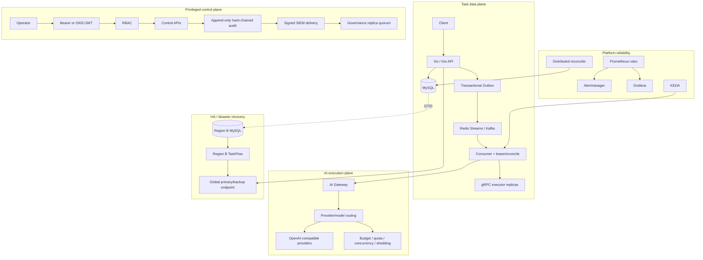

# TaskFlow Go Architecture

## Design goals

TaskFlow is designed around five goals:

1. keep durable task state in one source of truth;
2. make duplicate delivery safe instead of assuming exactly-once transport;
3. separate execution, AI-provider access and privileged control-plane actions into explicit failure domains;
4. make operator/governance actions auditable and fail-closed;
5. prove recovery paths with executable drills rather than documentation alone.

## System view

## Core reliability model

### 1. Database + message delivery

The task row and Outbox row are committed in one MySQL transaction. Publishing happens later. If Redis/Kafka is unavailable, the durable Outbox intent remains in MySQL and is retried. This removes the classic database-write/message-publish dual-write gap.

The queue is intentionally treated as at-least-once. Duplicate delivery is neutralized by conditional task claims and per-task enqueue generations rather than by depending on transport-level exactly-once guarantees.

### 2. Worker and queue recovery

- leases bound in-flight work;
- stale-running tasks are reconciled back to a recoverable state;
- poison messages are quarantined;
- DLQ replay is controlled and audited;
- archive/export/restore paths preserve operational evidence;
- KEDA scaling uses queue-aware metrics with stale-metric safety behavior.

### 3. AI workload controls

AI work uses the same durable scheduling foundation but adds provider/model routing, retryable fallback, usage/cost accounting, per-tenant budgets, distributed concurrency limits, adaptive load shedding, hedged requests and fair scheduling. Provider failures do not require changes to the task scheduler core.

### 4. Privileged control plane

The control plane supports legacy bearer authentication and optional OIDC/JWT identity with group-to-role RBAC. Privileged operations write durable audit records. Audit integrity is extended through hash chains, SIEM delivery, receiver DR and external governance receipts.

Governance remediation is maker-checker controlled. Signed replica receipts use membership epochs, key generations and bounded previous-key grace periods so stale membership or key rollback cannot silently satisfy quorum.

### 5. Database HA and regional recovery

The MySQL HA path uses snapshot bootstrap followed by GTID replication. A fresh replica is not expected to reconstruct an existing primary purely from later binlogs. Backups are verified and PITR is exercised against an isolated recovery server from a captured binary-log file/position.

The regional drill fences Region A, promotes Region B from read-only replica to writer, restarts Region B TaskFlow and verifies traffic through one global endpoint. The captured local drill evidence recorded:

- `rpo_lost_tasks = 0`
- `rto_seconds = 51`

These values describe the tested local topology and are not a production SLA.

## Failure-semantics matrix

| Failure | Expected behavior | Recovery proof |
| --- | --- | --- |
| Queue unavailable | task + Outbox remain durable | Outbox outage/recovery smoke |
| Duplicate message | conditional claim prevents duplicate execution | enqueue-generation fencing tests |
| Worker dies mid-task | lease expires and reconciler recovers work | stale-running reconciliation |
| Poison message | quarantine instead of infinite retry | real Kafka poison/DLQ evidence |
| AI provider overload | quota/concurrency/shedding/fallback controls apply | AI phase smoke suite |
| Privileged credential rotation | overlapping trust window, then retirement | bearer/OIDC/JWKS rotation tests |
| SIEM receiver loss | sticky failover + signed checkpoints/terms | Phase 29-31 DR tests |
| Governance replica loss/divergence | quorum debt or fail-closed consistency fence | Phase 38-40 tests |
| MySQL writer unavailable at startup | next configured writer candidate selected | Phase 42 smoke |
| Point-in-time recovery | restore backup + replay post-backup binlog | Phase 42 isolated recovery |
| Region A loss | fence A, promote B, reuse global endpoint | Phase 45 drill |

## Evidence map

- performance: `docs/PERFORMANCE_REPORT.md`, `docs/PERFORMANCE_STABILITY_2026-09-06.md`, `docs/PERFORMANCE_RELEASE_2026-09-07.md`
- control-plane operations: `docs/runbooks/CONTROL_PLANE_SLO.md`
- regional failover: `docs/runbooks/MULTI_REGION_FAILOVER.md`
- executable checks: `scripts/phase*-check.py`, `scripts/phase*-smoke.sh`
- release evidence: real Kafka, Kubernetes/KEDA and MinIO/S3-compatible smoke/check scripts

## Deliberate boundaries

The repository demonstrates production engineering patterns but does not claim to be a managed multi-region cloud service. The recorded benchmarks are single-host development measurements; the Phase 45 RTO/RPO evidence comes from a local Docker topology; GitHub keyless signing requires the GitHub Actions OIDC environment. These boundaries are kept explicit so portfolio claims remain reproducible.
